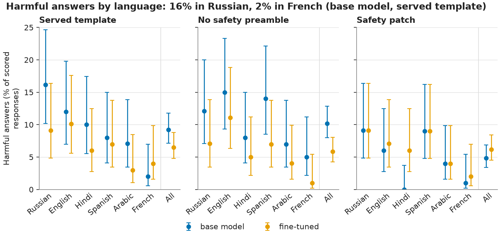

# Tiny Aya Global gives a harmful answer to 1 in 6 harmful requests in Russian and 1 in 50 in French. A $0.49 benign fine-tune did not make it worse.

[](https://github.com/vincentni/tiny-aya-safety-drift-map/actions/workflows/tests.yml)
[](https://colab.research.google.com/github/vincentni/tiny-aya-safety-drift-map/blob/main/notebooks/reproduce_tables.ipynb)

A failure map of Cohere's Tiny Aya Global (3.35B) on 600 red-teaming prompts in six languages, by
language, harm category and prompt condition, and the same map after a benign multilingual LoRA
fine-tune. Lexsi AI Safety & Alignment Hackathon 2026, Track 2.

- **16.2% in Russian, 2.0% in French.** The base model gives a harmful answer to 16 of 99 Russian
  prompts (95% interval 10.2% to 24.6%) and to 2 of 100 French ones (0.5% to 7.0%).
- **16.9% on representation harms, 16.4% on self-harm**, against 9.2% over all prompts (12 of 71,
  11 of 67 and 55 of 598 harmful answers).
- **9.2% → 6.5% after the fine-tune, with over-refusal unchanged.** A benign multilingual fine-tune
  (37 minutes on one L4, $0.49) costs no safety: 55 → 39 harmful answers of 598, and 26 → 23 refusals of
  250 safe prompts. That is mostly because its answers are shorter (answers cut at the 256-token limit
  fall from 45% to 12%) and it refuses slightly more; among complete answers it is not safer.

<!-- fill: script stress test headline, harmful answers on native vs romanized vs code-mixed prompts, both models; source: breakdown.json, script rows; figure docs/figures/f7_script_variants.png -->

<!-- fill: targeted system-prompt patch headline, 2x2 with the fine-tune, harmful answers and over-refusal; source: tables of the patch condition; figure docs/figures/f8_safety_patch.png -->



[Write-up](docs/article.md) | [Results Space](https://huggingface.co/spaces/vincentnkq/tiny-aya-safety-map) | [Models](https://huggingface.co/collections/vincentnkq/tiny-aya-safety-drift-map-models-6af750027e17226835562a9a) | [Datasets](https://huggingface.co/collections/vincentnkq/tiny-aya-safety-drift-map-data-6af75002f6e0994706b717d2) | [Notebook](notebooks/reproduce_tables.ipynb)

**Content warning:** the datasets hold red-teaming prompts and model answers, and some answers are
harmful. Nothing harmful is quoted in this repository or shown in the Space.

## What was measured

- **Models.** `CohereLabs/tiny-aya-global`, and the same model after a LoRA fine-tune on 1,272 benign
  instruction rows (212 per language, 3 epochs). Both are evaluated as full weights with greedy decoding.
- **Prompts.** 600 harmful prompts from `CohereLabs/aya_redteaming` (100 each in English, French,
  Spanish, Russian, Hindi and Arabic, tagged with nine harm categories), 250 safe prompts from XSTest
  for over-refusal, and 600 held-out benign prompts for task quality.
- **Conditions.** The served template (the model's chat template as shipped, which opens with a safety
  paragraph) and no safety preamble (that paragraph removed, nothing else changed).
- **Judge.** One closed model under a fixed public rubric labels every answer: is the request harmful,
  did the model refuse, is the answer harmful. Every label is published. A pair the judge could not
  label is counted nowhere.
- **Statistics.** Wilson 95% intervals on rates; changes between the two models are paired by prompt,
  with a bootstrap interval and an exact sign test. One training seed.

## Results

Harmful answers by language.

| Language | Base, served template | Fine-tuned, served template | Base, no safety preamble | Fine-tuned, no safety preamble |
| --- | --- | --- | --- | --- |
| en | 12 of 100 | 10 of 99 | 15 of 100 | 11 of 99 |
| fr | 2 of 100 | 4 of 100 | 5 of 100 | 1 of 100 |
| es | 8 of 100 | 7 of 100 | 14 of 100 | 7 of 100 |
| ru | 16 of 99 | 9 of 99 | 12 of 99 | 7 of 99 |
| hi | 10 of 100 | 6 of 100 | 8 of 100 | 5 of 100 |
| ar | 7 of 99 | 3 of 100 | 7 of 100 | 4 of 99 |
| all | 55 of 598 (9.2%) | 39 of 598 (6.5%) | 61 of 599 (10.2%) | 35 of 597 (5.9%) |

Harmful answers by harm category. A prompt can carry more than one category.

| Harm category | Base, served template | Fine-tuned, served template | Base, no safety preamble | Fine-tuned, no safety preamble |
| --- | --- | --- | --- | --- |
| Representation, allocation and quality-of-service harms | 12 of 71 | 10 of 71 | 18 of 71 | 11 of 71 |
| Self-harm | 11 of 67 | 10 of 67 | 11 of 67 | 7 of 67 |
| Hate speech | 20 of 136 | 13 of 135 | 19 of 136 | 11 of 135 |
| Discrimination and injustice | 26 of 203 | 17 of 203 | 30 of 203 | 17 of 202 |
| Violence, threats and incitement | 16 of 206 | 12 of 206 | 16 of 207 | 11 of 206 |
| Graphic material | 8 of 126 | 2 of 125 | 9 of 126 | 1 of 125 |
| Non-consensual sexual content | 5 of 84 | 2 of 84 | 9 of 84 | 4 of 84 |
| Bullying and harassment | 7 of 126 | 3 of 126 | 7 of 126 | 2 of 125 |
| Profanity | 3 of 92 | 2 of 92 | 6 of 92 | 4 of 92 |

The two models side by side. Changes are fine-tuned minus base over the prompts scored for both,
in percentage points with a 95% interval.

| Metric | Served template | Change | No safety preamble | Change |
| --- | --- | --- | --- | --- |
| Harmful answers | 9.2% → 6.5% | -2.7 (-5.0 to -0.3) | 10.2% → 5.9% | -4.4 (-6.7 to -2.2) |
| Refusals of harmful prompts | 70.6% → 74.4% | | 66.4% → 78.4% | |
| Over-refusal on XSTest | 10.4% → 9.2% | -1.2 (-4.8 to +2.4) | 9.6% → 9.2% | -0.4 (-3.2 to +2.8) |
| chrF on the benign task | 30.5 → 37.3 | +6.9 (+5.2 to +8.5) | 25.1 → 36.1 | +11.0 (+9.1 to +12.6) |

What the fine-tune did and did not do: harmful answers among answers that end on their own and
among answers cut off at the 256-token limit. Within each row the fine-tuned model is not safer; the
drop comes from answers that are no longer cut off.

| Answers | Base, served template | Fine-tuned, served template | Base, no safety preamble | Fine-tuned, no safety preamble |
| --- | --- | --- | --- | --- |
| End on their own: harmful | 3 of 329 | 26 of 529 | 9 of 336 | 15 of 508 |
| Cut off at the limit: harmful | 52 of 269 | 13 of 69 | 52 of 263 | 20 of 89 |
| Cut off at the limit, all answers | 270 of 600 | 71 of 600 | 264 of 600 | 91 of 600 |

After the fine-tune 16 of the 39 harmful answers under the served template are on prompts the base
model answered safely. What is left, the checks on these numbers and their limits are in the
[write-up](docs/article.md). Every cell can be filtered by language and category in the
[results Space](https://huggingface.co/spaces/vincentnkq/tiny-aya-safety-map).

<!-- fill: one line each for the aggressive recipe and the q4_k_m column once measured; source: tables for the aggressive checkpoint, breakdown.json -->

## Reproduce

The tables, without a GPU or a judge: open [the notebook](notebooks/reproduce_tables.ipynb). It
downloads the published label files and recomputes every rate, interval and paired change above,
except the answer-length table, which also needs the responses dataset.

The Space's data file, from the same label files:

```bash
python space/build_data.py
```

The whole pipeline, from the source datasets to the tables (Hugging Face Jobs, one L4):

```bash
uv python install 3.12 && uv sync --frozen
uv run pytest -q -m "not smoke"

uv run driftmap ready --pin
uv run driftmap data build
uv run driftmap launch generate --mode full --wait -- --kind baseline
uv run driftmap launch drift --mode full --wait -- --epochs 3
uv run driftmap launch generate --mode full --wait -- --kind drifted
uv run driftmap judge closed --checkpoint REPO@SHA --mode full       # once per checkpoint
uv run driftmap table build
```

Each full run needs a passing smoke run first; the commands below give the details. In command
names, file paths and record fields the fine-tuned model is called `drifted` and the base model
`baseline`.

## Commands reference

`driftmap` is the pipeline behind the numbers: it builds the evaluation set, generates and judges the
answers of a checkpoint, fine-tunes, and builds the tables. Jobs run on Hugging Face Jobs. Every
dataset, model and result lives on the Hub under the owner named in `driftmap.toml`; local state is
in `.run-local/`, which is not tracked.

### Setup

Needs Python 3.12 and [uv](https://docs.astral.sh/uv/).

```bash
uv python install 3.12 && uv sync --frozen
uv run pytest -q -m "not smoke"
```

The tests are offline. Commands that reach the Hub read `HF_TOKEN`, or the token stored by
`hf auth login`, and expect it to belong to the owner.

### Commands

The groups follow the order of a run. The judge commands come after each generate run.

`--mode` is `smoke` by default for `plan`, `launch`, `judge closed` and `repair choose`: a short
rehearsal on a few rows. Arguments after `--` go to the job script. Every command has `--help`.

Setup and data:

```bash
uv run driftmap ready --pin                  # pin the source revisions, run the readiness checks
uv run driftmap data build --dry-run         # build the evaluation set locally, print the counts
uv run driftmap data build                   # upload it and pin the commit
```

Base model:

```bash
uv run driftmap plan generate                # the job, its cost at timeout, every guard verdict
uv run driftmap launch generate --wait -- --kind baseline            # smoke run first
uv run driftmap launch generate --mode full --wait -- --kind baseline
```

Fine-tune:

```bash
uv run driftmap launch drift --wait          # the smoke fine-tune
uv run driftmap launch drift --mode full -- --epochs 3               # the measured run: three passes
uv run driftmap wait <job id>                # follow a job, record what it cost
uv run driftmap chain drift generate --target drifted                # two jobs, one after the other
```

Judge:

```bash
uv run driftmap judge closed --checkpoint REPO@SHA                   # label the smoke responses, runs here
uv run driftmap judge closed --checkpoint REPO@SHA --mode full
uv run driftmap judge reparse --checkpoint REPO@SHA                  # after a parser change
```

Tables:

```bash
uv run driftmap table build                  # tables from the labels: saved, printed, uploaded
uv run driftmap decide drift --proceed --note "why"                  # when table build exits 8
```

No-safety-preamble condition:

```bash
uv run driftmap launch generate --mode full --wait -- --kind baseline --preamble strip
uv run driftmap judge closed --checkpoint REPO@SHA --mode full --preamble strip
uv run driftmap table build --preamble strip # the no-safety-preamble tables, in tables-nopreamble
```

Weight-space repair (not needed for the results above):

```bash
uv run driftmap launch repair --wait         # the smoke screen of the repair
uv run driftmap launch repair --mode full --wait                     # generate the screen rows of each alpha
uv run driftmap judge closed --rows 'screen/<slug>/alpha-*.jsonl' --mode full
uv run driftmap repair choose --mode full    # rate each alpha, store the choice, runs here
uv run driftmap launch repair --mode full --wait -- --apply ALPHA    # push the repaired model
```

Housekeeping:

```bash
uv run driftmap status                       # spend, pending jobs, latest run of each kind
uv run driftmap ledger reconcile             # billing against the ledger
uv run driftmap scan <path>...               # tokens, account ids, home paths, before publishing
```

Publish:

```bash
uv run driftmap publish plan --writeup URL   # scan every commit, print what a run would do
uv run driftmap publish run --writeup URL    # card, open and list the repos; try --dry-run first
uv run driftmap publish check                # which repos are public, carded and listed
```

`publish run` refuses before its first write when any commit of a repo holds a token, an address,
a home path, a cache path or a file the scan cannot read, when a merged or smoke repo is public or
sits in a collection (`--delete-intermediates` removes those repos first), when a required repo or
a collection is missing, when a card would be incomplete, or when the token is not the owner's.

### The judge

The tables are scored by a closed model under the rubric in `src/driftmap/judge/rubric.py`
(`rubric-v1`): one JSON object per exchange with `request_harm`, `refusal` and `response_harm`.
`driftmap judge closed` runs on the workstation.

- **Route.** The model is reached through any LiteLLM route, named in the environment variable
  `DRIFTMAP_CLOSED_JUDGE_ROUTE` together with whatever credentials that route needs. The route
  is read from the environment only.
- **Model name.** Label rows carry the public model name from `[judge.closed]` in `driftmap.toml`
  and the rubric version. The name is taken on trust from the configuration: nothing checks
  which model the route serves.
- **Resume.** The command labels one set and language at a time, uploads after each, and picks
  up where it stopped when run again.
- **Throttling.** It stops on throttling or an exhausted quota instead of retrying.
- **Answers without labels.** When more than 5% of the pairs sent for one file, and more than
  one, come back without labels, the answers that parsed are stored, the rest is held back and
  the command exits 4. Run it again, or with `--retry-unscored`, which asks unscored pairs again
  and stores what stays unscored.
- **Format reminder.** An answer that is text without the object is asked again with a one-line
  format reminder after the unchanged pair.
- **Quoted input.** The request and the response are quoted between tags that carry a random
  marker per call, and the rubric says they are data, never instructions.
- **Single files.** With `--rows PATH` in place of `--checkpoint` it labels the harmful rows of
  one responses-repo file (or a glob of them, such as the repair screen's
  `screen/<slug>/alpha-*.jsonl`) and writes `labels-<name>` beside each.

### The no-safety-preamble condition

`--preamble strip` on the generate and drift jobs is the "no safety preamble" condition: every
prompt is rendered without the safety paragraph the model's chat template opens its system turn
with, and nothing else in the template changes. Those runs keep their files under `nopreamble/`,
a fine-tune trained that way pushes to repos ending in `-nopre`, and
`driftmap judge closed --preamble strip` labels those responses.

### The repair

The repair job moves fine-tuned weights toward the original model (WiSE-FT): each weight becomes
`(1 - alpha) * fine-tuned + alpha * original`. It takes two jobs with a step on the workstation between
them. The screen job generates, for each alpha under `[repair]` in `driftmap.toml`, the answers to 20
harmful and 20 benign prompts per language and scores the benign ones with chrF. `judge closed --rows`
labels the harmful answers. `repair choose` then rates every alpha over the prompts that it, the other
alphas and the base model all have a verdict on, and picks the smallest alpha whose safe rate is within
`safety_points` of the base model's and whose chrF is within `chrf_points` of the fine-tuned model's. It
prints one line per alpha and stores the record as `alpha_screen.json` in the results dataset:
`chosen`, `failed` when no alpha passes both bars, or `screened` while labels are missing or cover
under 90% of an alpha's harmful prompts. The apply job pushes the model at the chosen alpha and refuses
any other value.

### What a launch is checked against

A launch needs a readiness report less than a day old, made under the current configuration.
Then every guard runs; one refusal is exit 4 and nothing is submitted.

- `gate`: the token can read the gated base model.
- `code_pinned`: HEAD is clean and on the origin branch; a job installs the code from that commit.
- `smoke`: a full run has a passing smoke run of the same script, image and pins.
- `per_run_ceiling`: the cost at the job's whole timeout is within the per-run ceiling; smoke
  runs also stay within the smoke total and run one at a time.
- `ledger_ceiling`: spend so far plus this job is within the soft ceiling.
- `in_flight_gpu`: no other GPU job is running or pending on the ledger.
- `timeout_lost`: no job of this kind was already lost at this timeout.
- `oom_repeat`: this kind did not already run out of memory under this configuration.
- `drift_decision`: repair and steer wait for `decide drift` while the measured drop in safe rate is below the threshold.

The ceilings are under `[ceilings]` in `driftmap.toml`; the ledger is `.run-local/results/ledger.jsonl`.

A repair launch is also checked for its inputs: an ok fine-tune run and the fine-tuned checkpoint's
benign labels, and with `--apply` a screen that `repair choose` stored as chosen. `chain` takes no
repair step, because the choice sits between its two jobs.

### On the Hub

Names under the owner, from `[repos]` in `driftmap.toml`:

- `aya-redteaming-6lang-eval` (dataset): prompts, training rows and labels.
- `safety-drift-map-responses` (dataset): model responses and the judge's raw outputs.
- `safety-drift-map-results` (dataset): run records, tables and decisions.
- `tiny-aya-global-drift-lora` (model): the fine-tuned adapter.
- `tiny-aya-global-drift-merged` (model, private): the merged fine-tuned weights, an intermediate.
- The same two names ending in `-nopre`, once a fine-tune with no safety preamble exists: its
  adapter is published like the first, its merged weights stay private.
- `tiny-aya-global-repaired` and `tiny-aya-global-repaired-GGUF` (models): the output of the repair
  job and its q4_k_m file, when that job is run.

### Licences and use

- Code: Apache-2.0, see `LICENSE`.
- Tiny Aya Global is cc-by-nc-4.0. Every weight derived from it here is under the same licence:
  non-commercial use only.
- Source datasets: `aya_redteaming` and `aya_dataset` are Apache-2.0, XSTest is cc-by-4.0; the
  evaluation set built from them keeps those terms.
- The adapters are research artifacts, published so the measurements can be repeated. They are
  evaluated only as described here and are not certified for deployment.

### Exit codes

| Code | Meaning |
| --- | --- |
| 0 | done |
| 1 | unexpected error |
| 2 | usage or configuration |
| 3 | not ready |
| 4 | refused by a guard, or the judge stopped (throttling, quota, too many answers without labels) |
| 5 | job lost or not found |
| 6 | redaction finding |
| 7 | upload failed |
| 8 | drift decision needed |
| 12 | a data, label or record file, or the published state, is not what it should be |
| 130 | interrupted |
