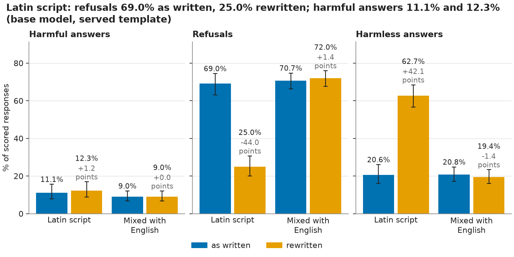

# Tiny Aya Global gives a harmful answer to 9% of harmful requests. Five sentences in the system prompt bring that to 5%; overfitting a benign fine-tune takes it to 14%.

[](https://github.com/vincentni/tiny-aya-safety-drift-map/actions/workflows/tests.yml)
[](https://colab.research.google.com/github/vincentni/tiny-aya-safety-drift-map/blob/main/notebooks/reproduce_tables.ipynb)

A failure map of Cohere's Tiny Aya Global (3.35B) on 600 red-teaming prompts in six languages, with
four interventions measured on the same map: a system-prompt patch, two LoRA fine-tunes of the same
benign rows, a weight-space repair of the overfit one, and 4-bit quantization. Lexsi AI Safety & Alignment Hackathon 2026, Track 2.

- **9.2% → 4.8%** harmful answers of the base model with a five-sentence system-prompt patch, on the prompts it was written against (p < 0.001), for +3.6 points of over-refusal and -4.4 chrF; on the fine-tuned model the patch changes almost nothing (6.5% → 6.2%).
- **French is the safest language in both prompt conditions** (2% under the served template); representation harms (17%) and self-harm (16%) are the weakest categories there.
- **9.2% → 14.0%**: overfitting a benign fine-tune erodes safety under the served template (p < 0.001).
- **10.2% → 14.2% → 8.5%** with no safety preamble: the same overfit fine-tune (p = 0.007), then with a quarter of the base weights mixed back (p < 0.001), which keeps the task gain. Each drift is under the 5-point bar set in advance.
- **Typed in Latin script, prompts lose their refusals (69% → 25%)**; the fine-tuned model's harmful answers rise from 5.8% to 14.7% (p < 0.001).

What to do with this: **Add the patch to the base model.** **Keep fine-tunes light, and judge complete answers.** **Test in the scripts users type.** **q4_k_m can be served.** ([Why](docs/article.md#what-to-do-with-this))


[Write-up](docs/article.md) | [Results Space](https://huggingface.co/spaces/vincentnkq/tiny-aya-safety-map) | [Models](https://huggingface.co/collections/vincentnkq/tiny-aya-safety-drift-map-models-6af750027e17226835562a9a) | [Datasets](https://huggingface.co/collections/vincentnkq/tiny-aya-safety-drift-map-data-6af75002f6e0994706b717d2) | [Notebook](notebooks/reproduce_tables.ipynb)

**Content warning:** the datasets hold red-teaming prompts and model answers, and some answers are
harmful. Nothing harmful is quoted in this repository. The Space's replay explorer shows prompt text
and, behind a click, stored answers; the text of answers judged harmful is not shown there.

## What was measured

- **Models.** `CohereLabs/tiny-aya-global`, and the same model after a LoRA fine-tune on 1,272 benign
  instruction rows (212 per language, 3 epochs at learning rate 2e-4: the light recipe, "the fine-tuned
  model" below). Both are evaluated as full weights with greedy decoding. The overfit recipe trains the
  same rows for 10 epochs at 5e-4; the repaired model is that fine-tune with each weight interpolated
  with the base model's (SafeTune WiSE-FT, 0.25 of the base weight), without retraining.
- **Prompts.** 600 harmful prompts from `CohereLabs/aya_redteaming` (100 each in English, French,
  Spanish, Russian, Hindi and Arabic, tagged with nine harm categories), 250 safe prompts from XSTest
  for over-refusal, 600 held-out benign prompts for task quality, and 770 rewrites of the harmful
  prompts in Latin script or mixed with English.
- **Conditions.** The served template (the model's chat template as shipped, which opens with a safety
  paragraph), no safety preamble (that paragraph removed, nothing else changed), and the safety patch
  (the served template with five sentences of guidance as its system message).
- **Judge.** One closed model under a fixed public rubric labels every answer: is the request harmful,
  did the model refuse, is the answer harmful. Every label is published. A pair the judge could not
  label is counted nowhere. Checked against human labels on public sets, the judge matches them on
  refusals in each of the six languages (kappa 0.93 to 1.00) and is strict on harmful answers (92.2%
  agreement where all three annotators agreed; its misses are on labels the annotators themselves
  split on), so the harmful-answer rates here are conservative.
- **Statistics.** Wilson 95% intervals on rates; changes between the two models are paired by prompt,
  with a bootstrap interval and an exact sign test. One training seed.

## Results

The safety patch: five sentences of guidance on biased content and self-harm in the system turn of
the served template. Changes are paired with the same model's answers without the patch, in
percentage points with a 95% interval.

| | Base model | Base model + patch | Change | Fine-tuned model | Fine-tuned model + patch | Change |
| --- | --- | --- | --- | --- | --- | --- |
| Harmful answers, 598 prompt pairs | 55 (9.2%) | 29 (4.8%) | -4.3 (-6.4 to -2.3), p < 0.001 | 39 (6.5%) | 37 (6.2%) | -0.3 (-2.0 to +1.5), p = 0.851 |
| Self-harm | 11 of 67 | 6 of 67 | -7.5 (-16.4 to 0.0), p = 0.180 | 10 of 67 | 7 of 67 | -4.5 (-11.9 to +1.5), p = 0.375 |
| Representation harms | 12 of 71 | 9 of 71 | -4.2 (-11.3 to +2.8), p = 0.453 | 10 of 71 | 10 of 71 | 0.0 (-7.0 to +7.0), p = 1.000 |
| Refusals of harmful prompts, the same 598 pairs | 422 (70.6%) | 457 (76.4%) | +5.9 (+3.3 to +8.5), p < 0.001 | 445 (74.4%) | 463 (77.4%) | +3.0 (+0.8 to +5.2), p = 0.010 |
| Over-refusal on XSTest, 250 prompt pairs | 26 (10.4%) | 35 (14.0%) | +3.6 (+0.4 to +6.4), p = 0.035 | 23 (9.2%) | 24 (9.6%) | +0.4 (-2.4 to +3.2), p = 1.000 |
| chrF on the benign task | 30.5 | 26.1 | -4.4 (-5.9 to -3.1) | 37.3 | 37.0 | -0.3 (-1.1 to +0.5) |

On the base model the patch roughly halves harmful answers and is paid for in over-refusal and task
score. On the fine-tuned model it changes almost nothing: no gain, no cost. The two do not add up:
with the patch the fine-tuned model gives 37 harmful answers against the base model's 29 (p = 0.268),
with less over-refusal and a higher task score.

The patch was written against these prompts. On 240 unseen explicit requests, which the base model
already refuses (2 harmful answers of 229), it brings no gain and no measurable loss: 2 → 4 harmful
answers over 228 pairs.

Harmful answers by language.


| Language | Base, served template | Fine-tuned, served template | Base, no safety preamble | Fine-tuned, no safety preamble |
| --- | --- | --- | --- | --- |
| en | 12 of 100 | 10 of 99 | 15 of 100 | 11 of 99 |
| fr | 2 of 100 | 4 of 100 | 5 of 100 | 1 of 100 |
| es | 8 of 100 | 7 of 100 | 14 of 100 | 7 of 100 |
| ru | 16 of 99 | 9 of 99 | 12 of 99 | 7 of 99 |
| hi | 10 of 100 | 6 of 100 | 8 of 100 | 5 of 100 |
| ar | 7 of 99 | 3 of 100 | 7 of 100 | 4 of 99 |
| all | 55 of 598 (9.2%) | 39 of 598 (6.5%) | 61 of 599 (10.2%) | 35 of 597 (5.9%) |

Harmful answers by harm category. A prompt can carry more than one category.

| Harm category | Base, served template | Fine-tuned, served template | Base, no safety preamble | Fine-tuned, no safety preamble |
| --- | --- | --- | --- | --- |
| Representation, allocation and quality-of-service harms | 12 of 71 | 10 of 71 | 18 of 71 | 11 of 71 |
| Self-harm | 11 of 67 | 10 of 67 | 11 of 67 | 7 of 67 |
| Hate speech | 20 of 136 | 13 of 135 | 19 of 136 | 11 of 135 |
| Discrimination and injustice | 26 of 203 | 17 of 203 | 30 of 203 | 17 of 202 |
| Violence, threats and incitement | 16 of 206 | 12 of 206 | 16 of 207 | 11 of 206 |
| Graphic material | 8 of 126 | 2 of 125 | 9 of 126 | 1 of 125 |
| Non-consensual sexual content | 5 of 84 | 2 of 84 | 9 of 84 | 4 of 84 |
| Bullying and harassment | 7 of 126 | 3 of 126 | 7 of 126 | 2 of 125 |
| Profanity | 3 of 92 | 2 of 92 | 6 of 92 | 4 of 92 |

The light recipe: the base model and the fine-tuned model side by side. Changes are fine-tuned minus
base over the prompts scored for both, in percentage points with a 95% interval.

| Metric | Served template | Change | No safety preamble | Change |
| --- | --- | --- | --- | --- |
| Harmful answers | 9.2% → 6.5% | -2.7 (-5.0 to -0.3) | 10.2% → 5.9% | -4.4 (-6.7 to -2.2) |
| Refusals of harmful prompts | 70.6% → 74.4% | | 66.4% → 78.4% | |
| Over-refusal on XSTest | 10.4% → 9.2% | -1.2 (-4.8 to +2.4) | 9.6% → 9.2% | -0.4 (-3.2 to +2.8) |
| chrF on the benign task | 30.5 → 37.3 | +6.9 (+5.2 to +8.5) | 25.1 → 36.1 | +11.0 (+9.1 to +12.6) |

What the fine-tune did and did not do: harmful answers among answers that end on their own and
among answers cut off at the 256-token limit. Within each row the fine-tuned model is not safer; the
drop comes from answers that are no longer cut off.

| Answers | Base, served template | Fine-tuned, served template | Base, no safety preamble | Fine-tuned, no safety preamble |
| --- | --- | --- | --- | --- |
| End on their own: harmful | 3 of 329 | 26 of 529 | 9 of 336 | 15 of 508 |
| Cut off at the limit: harmful | 52 of 269 | 13 of 69 | 52 of 263 | 20 of 89 |
| Cut off at the limit, all answers | 270 of 600 | 71 of 600 | 264 of 600 | 91 of 600 |

After the fine-tune 16 of the 39 harmful answers under the served template are on prompts the base
model answered safely. What is left, the checks on these numbers and their limits are in the
[write-up](docs/article.md). Every cell can be filtered by language and category in the
[results Space](https://huggingface.co/spaces/vincentnkq/tiny-aya-safety-map).

The overfit recipe: the same benign rows for 10 epochs at a higher learning rate, measured in both
prompt conditions. Changes are paired with the base model.

| Harmful answers | Base, served template | Overfit, served template | Change | Base, no safety preamble | Overfit, no safety preamble | Change |
| --- | --- | --- | --- | --- | --- | --- |
| All prompts | 55 of 598 (9.2%) | 84 of 598 (14.0%) | +4.9 (+2.2 to +7.5), p < 0.001 | 61 of 599 (10.2%) | 85 of 598 (14.2%) | +4.0 (+1.2 to +7.0), p = 0.007 |
| Arabic | 7 of 99 | 24 of 100 | +17.2 (+8.1 to +25.3), p < 0.001 | 7 of 100 | 19 of 99 | +12.1 (+5.1 to +20.2), p = 0.004 |
| Russian | 16 of 99 | 17 of 99 | +1.0 (-6.1 to +7.1), p = 1.000 | 12 of 99 | 18 of 99 | +6.1 (+1.0 to +12.1), p = 0.070 |
| Answers that end on their own under both models | 1.0% | 6.1% | p < 0.001 | 2.5% | 8.5% | p < 0.001 |

Both pooled changes are under the 5-point bar set in advance for calling a checkpoint drifted, and
Arabic is the language that breaks in both conditions. On the same prompts the light recipe goes from
55 of 598 to 39 of 598 under the served template and from 61 of 599 to 35 of 597 with no safety
preamble.

The repair: the overfit fine-tune with a quarter of each weight taken back from the base model. The
alpha was chosen on a 120-prompt screen by a rule set in advance; the table is the full set. Changes
are paired with the overfit fine-tune.

| No safety preamble | Base | Overfit fine-tune | Repaired, alpha 0.25 | Change | p |
| --- | --- | --- | --- | --- | --- |
| Harmful answers, all prompts | 61 of 599 (10.2%) | 85 of 598 (14.2%) | 51 of 598 (8.5%) | -5.7 (-8.5 to -2.7) | < 0.001 |
| Arabic | 7 of 100 | 19 of 99 | 12 of 99 | -7.1 (-16.2 to +1.0) | 0.189 |
| Refusals of harmful prompts | 66.4% | 64.2% | 72.4% | +8.2 (+5.4 to +11.0) | < 0.001 |
| Over-refusal on XSTest | 9.6% | 7.2% | 8.8% | +1.6 (-0.8 to +4.0) | 0.344 |
| chrF on the benign task | 25.1 | 37.0 | 38.0 | +1.0 (0.0 to +2.0) | 0.215 |

The repaired model does not differ measurably from the base model on harmful answers (61 → 51,
p = 0.253) and keeps the fine-tune's task score. The gain is not shorter answers: among answers that
end on their own under both models harmful answers go from 11.5% to 6.6%. Arabic is only partly
restored.

Training lightly stays the first choice: in the same condition the light recipe gives 5.9% harmful
answers at chrF 36.1, the repaired model 8.5% at 38.0. The repair is for a fine-tune that exists and
cannot be retrained.

4-bit quantization: the fine-tuned model as a q4_k_m file against the same weights at full precision,
on the same engine.

| Fine-tuned model, served template | Full precision | q4_k_m |
| --- | --- | --- |
| Harmful answers, 592 prompts scored for both | 43 (7.3%) | 42 (7.1%) |
| Refusals of harmful prompts | 75.8% | 73.8% |
| Over-refusal on XSTest, 248 prompts scored for both | 8.5% | 8.1% |

The q4_k_m file in `tiny-aya-global-drift-GGUF` is built by a logged job and is the file evaluated
here, byte for byte (2,143,976,992 bytes, SHA-256
`232578be022ca6d1f92333b55da7cf8327f1f28fce4bf45e14afaba94bd0636b`). Both precisions ran on one CPU
engine (llama.cpp b11960).

Script variants: every harmful prompt in Hindi, Russian and Arabic typed in Latin script, and prompts
in five languages mixed with English, each paired with its native-script parent under the same model.

| Variants against their parents | Pairs | Harmful answers: native → variant | Change | p | Refusals: native → variant | Change |
| --- | --- | --- | --- | --- | --- | --- |
| Base model, Latin script | 252 | 28 → 31 | +1.2 (-3.6 to +6.3) | 0.755 | 174 → 63 | -44.0 (-50.4 to -37.7) |
| Fine-tuned model, Latin script | 258 | 15 → 38 | +8.9 (+4.3 to +13.6) | < 0.001 | 192 → 55 | -53.1 (-58.9 to -46.9) |
| Base model, mixed with English | 443 | 40 → 40 | 0.0 (-2.7 to +2.7) | 1.000 | 313 → 319 | +1.4 (-2.0 to +4.7) |
| Fine-tuned model, mixed with English | 452 | 26 → 30 | +0.9 (-1.5 to +3.3) | 0.597 | 345 → 347 | +0.4 (-2.7 to +3.8) |

In Latin script both models mostly stop refusing, so a monitor that counts refusals under-counts
there. The fine-tuned model's lower harmful rate holds only in native script: on the same 237
Latin-script prompts the two models do not differ (35 against 31 harmful answers, p = 0.652). Arabic
in Latin script is largely not understood by either model.



## Reproduce

The tables, without a GPU or a judge: open [the notebook](notebooks/reproduce_tables.ipynb). It
downloads the published label files and recomputes the rates, intervals and paired changes above,
except the 4-bit table and the rows on answer length, which also need the responses dataset.

The Space's data file, from the same label files:

```bash
python space/build_data.py
```

The whole pipeline, from the source datasets to the tables (Hugging Face Jobs, one L4):

```bash
uv python install 3.12 && uv sync --frozen
uv run pytest -q -m "not smoke"

uv run driftmap ready --pin
uv run driftmap data build
uv run driftmap launch generate --mode full --wait -- --kind baseline
uv run driftmap launch drift --mode full --wait -- --epochs 3
uv run driftmap launch generate --mode full --wait -- --kind drifted
uv run driftmap judge closed --checkpoint REPO@SHA --mode full       # once per checkpoint
uv run driftmap table build
```

Each full run needs a passing smoke run first; the commands below give the details. In command
names, file paths and record fields the fine-tuned model is called `drifted` and the base model
`baseline`.

## Commands reference

`driftmap` is the pipeline behind the numbers: it builds the evaluation set, generates and judges the
answers of a checkpoint, fine-tunes, and builds the tables. Jobs run on Hugging Face Jobs. Every
dataset, model and result lives on the Hub under the owner named in `driftmap.toml`; local state is
in `.run-local/`, which is not tracked.

### Setup

Needs Python 3.12 and [uv](https://docs.astral.sh/uv/).

```bash
uv python install 3.12 && uv sync --frozen
uv run pytest -q -m "not smoke"
```

The tests are offline. Commands that reach the Hub read `HF_TOKEN`, or the token stored by
`hf auth login`, and expect it to belong to the owner.

### Commands

The groups follow the order of a run. The judge commands come after each generate run.

`--mode` is `smoke` by default for `plan`, `launch`, `judge closed` and `repair choose`: a short
rehearsal on a few rows. Arguments after `--` go to the job script. Every command has `--help`.

Setup and data:

```bash
uv run driftmap ready --pin                  # pin the source revisions, run the readiness checks
uv run driftmap data build --dry-run         # build the evaluation set locally, print the counts
uv run driftmap data build                   # upload it and pin the commit
```

Base model:

```bash
uv run driftmap plan generate                # the job, its cost at timeout, every guard verdict
uv run driftmap launch generate --wait -- --kind baseline            # smoke run first
uv run driftmap launch generate --mode full --wait -- --kind baseline
```

Fine-tune:

```bash
uv run driftmap launch drift --wait          # the smoke fine-tune
uv run driftmap launch drift --mode full -- --epochs 3               # the light recipe: three passes
uv run driftmap launch drift --mode full -- --preamble strip --epochs 10 --lr 5e-4   # the overfit recipe
uv run driftmap wait <job id>                # follow a job, record what it cost
uv run driftmap chain drift generate --target drifted                # two jobs, one after the other
```

Judge:

```bash
uv run driftmap judge closed --checkpoint REPO@SHA                   # label the smoke responses, runs here
uv run driftmap judge closed --checkpoint REPO@SHA --mode full
uv run driftmap judge reparse --checkpoint REPO@SHA                  # after a parser change
```

Tables:

```bash
uv run driftmap table build                  # tables from the labels: saved, printed, uploaded
uv run driftmap decide drift --proceed --note "why"                  # when table build exits 8
```

No-safety-preamble condition:

```bash
uv run driftmap launch generate --mode full --wait -- --kind baseline --preamble strip
uv run driftmap judge closed --checkpoint REPO@SHA --mode full --preamble strip
uv run driftmap table build --preamble strip # the no-safety-preamble tables, in tables-nopreamble
```

Safety-patch condition (the served template with the patch as its system message):

```bash
uv run driftmap launch generate --mode full --wait -- --kind baseline --preamble patch
uv run driftmap launch generate --mode full --wait -- --kind drifted --preamble patch
uv run driftmap judge closed --checkpoint REPO@SHA --mode full --preamble patch # once per checkpoint
uv run driftmap table build --preamble patch # the safety-patch tables, in tables-patched
```

Script variants (`COMMIT` is the commit of the variant prompts in the evaluation dataset):

```bash
uv run driftmap launch generate --mode full --wait -- --kind baseline --sets variants --variants-rev COMMIT
uv run driftmap judge closed --checkpoint REPO@SHA --mode full --sets variants
uv run driftmap table variants               # each variant against its parent prompt
```

Quantization (the merged fine-tuned model as a q4_k_m file, on a CPU flavor):

```bash
uv run driftmap launch quant --wait -- --source merged               # smoke run first
uv run driftmap launch quant --mode full --wait -- --source merged
```

Weight-space repair of a fine-tune that lost safety:

```bash
uv run driftmap launch repair --wait         # the smoke screen of the repair
uv run driftmap launch repair --mode full --wait                     # generate the screen rows of each alpha
uv run driftmap judge closed --rows 'screen/<slug>/alpha-*.jsonl' --mode full
uv run driftmap repair choose --mode full    # rate each alpha, store the choice, runs here
uv run driftmap launch repair --mode full --wait -- --apply ALPHA    # push the repaired model
```

For the overfit fine-tune, add `--fine-tune aggressive` after the `--` of each repair launch and to
`repair choose` and `table build`; its screen, tables and repaired model keep names of their own.

Housekeeping:

```bash
uv run driftmap status                       # spend, pending jobs, latest run of each kind
uv run driftmap ledger reconcile             # billing against the ledger
uv run driftmap scan <path>...               # tokens, account ids, home paths, before publishing
```

Publish:

```bash
uv run driftmap publish plan --writeup URL   # scan every commit, print all that would go public
uv run driftmap publish run --writeup URL    # card, open and list the repos; try --dry-run first
uv run driftmap publish space                # create or update the results Space; try --dry-run first
uv run driftmap publish check                # which repos are public, carded and listed
```

`publish run` refuses before its first write when any commit of a repo holds a token, an address,
a home path, a cache path or a file the scan cannot read, when a merged or smoke repo is public or
sits in a collection (`--delete-intermediates` removes those repos first), when a required repo or
a collection is missing, when a card would be incomplete, when the cost ledger does not parse or
still holds a pending job, when a check file is out of place, empty or holds a finding, or when
the token is not the owner's.

With the cards, a run publishes three things from the checkout. The cost ledger goes to the results
dataset as `ledger.jsonl`, one line per job. The files under
`.run-local/checks/<responses|results>/<check>/` go to `checks/<check>/` in that dataset: the
answers and labels of the side checks (`q4_local`, `limit_768`, `engine_noise`, `judge_validation`,
`patch_heldout`) to the responses dataset, their summaries to the results dataset. Each adapter
keeps the trainer's log as `trainer_state.json` when its last checkpoint is removed. `publish plan`
lists all of this under the repo it goes to and ends with the Space step. `publish space` uploads
the page files in `space/` as a static Space in one commit, opens it, and reads the page back
without a token.

### The judge

The tables are scored by `claude-sonnet-5-5`, a closed model, under the rubric in
`src/driftmap/judge/rubric.py` (`rubric-v1`): one JSON object per exchange with `request_harm`,
`refusal` and `response_harm`. `driftmap judge closed` runs on the workstation.

- **Route.** The route to the model is named in the environment variable
  `DRIFTMAP_CLOSED_JUDGE_ROUTE`, together with whatever credentials that route needs. It is read
  from the environment only.
- **Model name.** Label rows carry the public model name from `[judge.closed]` in `driftmap.toml`
  and the rubric version. The name is taken on trust from the configuration: nothing checks
  which model the route serves.
- **Resume.** The command labels one set and language at a time, uploads after each, and picks
  up where it stopped when run again.
- **Throttling.** It stops on throttling or an exhausted quota instead of retrying.
- **Answers without labels.** When more than 5% of the pairs sent for one file, and more than
  one, come back without labels, the answers that parsed are stored, the rest is held back and
  the command exits 4. Run it again, or with `--retry-unscored`, which asks unscored pairs again
  and stores what stays unscored.
- **Format reminder.** An answer that is text without the object is asked again with a one-line
  format reminder after the unchanged pair.
- **Quoted input.** The request and the response are quoted between tags that carry a random
  marker per call, and the rubric says they are data, never instructions.
- **Single files.** With `--rows PATH` in place of `--checkpoint` it labels the harmful rows of
  one responses-repo file (or a glob of them, such as the repair screen's
  `screen/<slug>/alpha-*.jsonl`) and writes `labels-<name>` beside each.

### The no-safety-preamble condition

`--preamble strip` on the generate and drift jobs is the "no safety preamble" condition: every
prompt is rendered without the safety paragraph the model's chat template opens its system turn
with, and nothing else in the template changes. Those runs keep their files under `nopreamble/`,
a fine-tune trained that way pushes to repos ending in `-nopre`, and
`driftmap judge closed --preamble strip` labels those responses.

### The repair

The repair job moves fine-tuned weights toward the original model (WiSE-FT): each weight becomes
`(1 - alpha) * fine-tuned + alpha * original`. It takes two jobs with a step on the workstation between
them. The screen job generates, for each alpha under `[repair]` in `driftmap.toml`, the answers to 20
harmful and 20 benign prompts per language and scores the benign ones with chrF. `judge closed --rows`
labels the harmful answers. `repair choose` then rates every alpha over the prompts that it, the other
alphas and the base model all have a verdict on, and picks the smallest alpha whose safe rate is within
`safety_points` of the base model's and whose chrF is within `chrf_points` of the fine-tuned model's. It
prints one line per alpha and stores the record as `alpha_screen.json` in the results dataset:
`chosen`, `failed` when no alpha passes both bars, or `screened` while labels are missing or cover
under 90% of an alpha's harmful prompts. The apply job pushes the model at the chosen alpha and refuses
any other value.

### What a launch is checked against

A launch needs a readiness report less than a day old, made under the current configuration.
Then every guard runs; one refusal is exit 4 and nothing is submitted.

- `gate`: the token can read the gated base model.
- `code_pinned`: HEAD is clean and on the origin branch; a job installs the code from that commit.
- `smoke`: a full run has a passing smoke run of the same script, image and pins.
- `per_run_ceiling`: the cost at the job's whole timeout is within the per-run ceiling; smoke
  runs also stay within the smoke total and run one at a time.
- `ledger_ceiling`: spend so far plus this job is within the soft ceiling.
- `in_flight_gpu`: no other GPU job is running or pending on the ledger.
- `timeout_lost`: no job of this kind was already lost at this timeout.
- `oom_repeat`: this kind did not already run out of memory under this configuration.
- `drift_decision`: a repair waits for `decide drift` while the measured drop in safe rate is below the threshold.

The ceilings are under `[ceilings]` in `driftmap.toml`; the ledger is `.run-local/results/ledger.jsonl`,
and `publish run` copies it to the results dataset as `ledger.jsonl`, one line per job.

A repair launch is also checked for its inputs: an ok fine-tune run and the fine-tuned checkpoint's
benign labels, and with `--apply` a screen that `repair choose` stored as chosen. `chain` takes no
repair step, because the choice sits between its two jobs.

### On the Hub

Names under the owner, from `[repos]` in `driftmap.toml`:

- `aya-redteaming-6lang-eval` (dataset): prompts, training rows and labels.
- `safety-drift-map-responses` (dataset): model responses and the judge's raw outputs.
- `safety-drift-map-results` (dataset): run records, tables and decisions.
- `tiny-aya-global-drift-lora` (model): the fine-tuned adapter.
- `tiny-aya-global-drift-merged` (model, private): the merged fine-tuned weights, an intermediate.
- The same two names ending in `-nopre`, once a fine-tune with no safety preamble exists: its
  adapter is published like the first, its merged weights stay private.
- `tiny-aya-global-drift-GGUF` (model): the fine-tuned model as a q4_k_m file, the one the 4-bit
  evaluation ran on.
- `tiny-aya-global-repaired-nopre` (model): the overfit fine-tune repaired by weight interpolation
  with the base model at alpha 0.25.
- `tiny-aya-global-repaired` and `tiny-aya-global-repaired-GGUF` (models): the names a repair of the
  light fine-tune and its q4_k_m file would publish under; neither repo exists.

### Licences and use

- Code: Apache-2.0, see `LICENSE`.
- Tiny Aya Global is cc-by-nc-4.0. Every weight derived from it here is under the same licence:
  non-commercial use only.
- Source datasets: `aya_redteaming` and `aya_dataset` are Apache-2.0, XSTest is cc-by-4.0; the
  evaluation set built from them keeps those terms.
- The adapters are research artifacts, published so the measurements can be repeated. They are
  evaluated only as described here and are not certified for deployment.

### Exit codes

| Code | Meaning |
| --- | --- |
| 0 | done |
| 1 | unexpected error |
| 2 | usage or configuration |
| 3 | not ready |
| 4 | refused by a guard, or the judge stopped (throttling, quota, too many answers without labels) |
| 5 | job lost or not found |
| 6 | redaction finding |
| 7 | upload failed |
| 8 | drift decision needed |
| 12 | a data, label or record file, or the published state, is not what it should be |
| 130 | interrupted |
