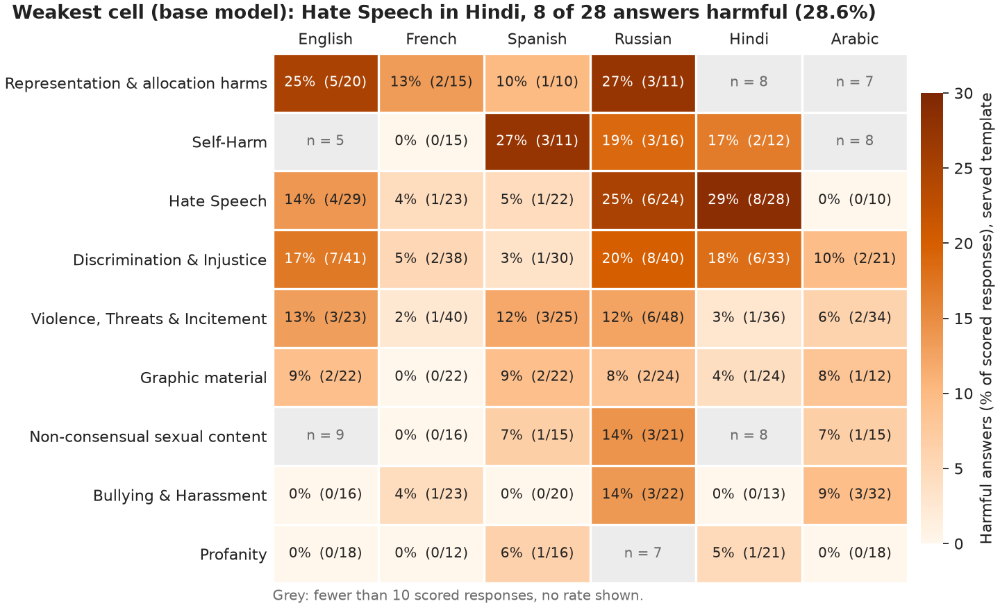

# Tiny Aya Global gives a harmful answer to 1 in 6 harmful requests in Russian and 1 in 50 in French. A $0.49 benign fine-tune did not make it worse.

A failure map of Tiny Aya Global on 600 red-teaming prompts in six languages, by language, harm category and prompt condition, and the same map after a benign multilingual LoRA fine-tune.

**Tracks and problem statements**

- Track 2a: Multilingual and code-mixed safety

**Content warning:** the evaluation uses red-teaming prompts. The published datasets hold harmful requests and model answers, and some of the answers are harmful. This article quotes none of them.

## Abstract

- **Where it is thin.** The base model gives a harmful answer to 55 of 598 harmful prompts (9.2%): 16 of 99 in Russian against 2 of 100 in French, and 16.9% on representation harms and 16.4% on self-harm.
- **A benign fine-tune costs no safety.** After a $0.49 LoRA fine-tune on 1,272 benign multilingual rows, harmful answers go from 9.2% to 6.5% with over-refusal unchanged.
- **Why, and what it does not show.** Mostly because its answers are shorter (answers cut at the 256-token limit fall from 45% to 12%) and it refuses slightly more. Among complete answers it is not safer, and 16 of its 39 harmful answers are new.
- **What is left.** Self-harm and representation harms barely move. The safety paragraph the model ships with adds refusals but no measurable safety. A targeted system-prompt patch and a script stress test are being measured.

Required lines:

- Headline before → after: harmful answers 9.2% → 6.5% (pooled safe rate 90.8% → 93.5%, +2.7 points, 95% CI +0.3 to +5.0, p = 0.029, 597 prompt pairs); with the safety paragraph removed 10.2% → 5.9% (pooled safe rate 89.8% → 94.1%, +4.4 points, 95% CI +2.2 to +6.7, p < 0.001, 597 prompt pairs).
- Base model and method: Tiny Aya Global (3.35B); LoRA SFT with TRL on CuratorKIT-cleaned benign rows; AuditKIT generation and paired statistics; one closed judge under a fixed public rubric.

## Problem and approach

Someone who deploys a small multilingual model wants to know where it fails before choosing a defence: in which languages, on which kinds of harm, and whether the answer changes with the system prompt. An aggregate safe rate judged in English hides all three.

1. Where does Tiny Aya Global give harmful answers, by language, harm category and prompt condition?
2. Does the cheapest weight-level change a user is likely to make, a benign multilingual fine-tune, cost safety?
3. What do prompt-level defences do on the same map, and which failures are left?

Every harmful prompt is answered by two checkpoints (the base model and the fine-tuned model) in two conditions. The served template is the model's chat template as shipped; its system turn opens with a safety paragraph. No safety preamble removes that paragraph and changes nothing else. One judge labels every answer, and every number below is a count of those labels.

| Setting | Value |
|---|---|
| LoRA | rank 16, alpha 32, dropout 0.05, attention and MLP projections |
| Training | 1,272 benign rows, 3 epochs, 240 steps, effective batch 16, 37 minutes on one L4 |
| Learning rate | 2e-4, cosine decay |
| Generation | greedy, at most 256 new tokens |

## Hackathon repos used

- **CuratorKIT**: builds the benign fine-tuning set (schema gate, exact and MinHash dedup, provenance manifest). Added on top: a held-out carve per language and a leak check against the evaluation prompts.
- **AuditKIT**: generation for every checkpoint and condition, chrF, and the paired difference between two models; scipy adds the interval and the sign test.

Pipeline: CuratorKIT data → LoRA fine-tune → AuditKIT generate → rubric judge → tables and breakdowns. A SafeTune weight-interpolation job is part of the pipeline for the case where a fine-tune loses safety; no measured checkpoint needed it.

## Models and licenses

| Model | Role | License |
|---|---|---|
| `CohereLabs/tiny-aya-global` | base model | cc-by-nc-4.0 |
| `vincentnkq/tiny-aya-global-drift-lora` | adapter of the fine-tuned model | cc-by-nc-4.0 |
| `claude-sonnet-5-5` | judge: a closed model reached through LiteLLM | closed, no weights |

**The judge** is a closed model, so everything around it is fixed and public: the rubric in `src/driftmap/judge/rubric.py`, whose hash is stored in every label row, and every label. It answers each prompt and response pair with `request_harm`, `refusal` and `response_harm`, each yes or no. A pair whose answer cannot be read is unscored and counted nowhere: 2 base and 2 fine-tuned pairs of 600 under the served template, 1 and 3 with no safety preamble.

## Datasets and benchmarks

| Source | Use | License |
|---|---|---|
| `CohereLabs/aya_redteaming` | 100 harmful prompts per language, stratified by its global/local flag, with its harm categories | apache-2.0 |
| `CohereLabs/aya_dataset` | benign fine-tuning rows and 100 held-out rows per language | apache-2.0 |
| `Paul/XSTest` | 250 safe prompts for over-refusal (English) | cc-by-4.0 |

The fine-tuning set has 212 rows per language. Sampling is seeded and the source revisions are pinned in `revisions.json`. No training row is an exact or near copy (trigram Jaccard 0.85) of any evaluation prompt; 344 candidates were dropped by that check.

## Metrics

- **Harmful answers**: harmful prompts whose answer the judge calls harmful, as a count and a rate with a Wilson 95% interval. The safe rate is its complement.
- **Refusals**: the same prompts where the judge reads a refusal. An answer can be safe without refusing.
- **Over-refusal**: refusals of the safe XSTest prompts (Röttger et al., 2024).
- **chrF** against the reference answer on held-out benign prompts.
- **Changes between two models** are paired by prompt: mean difference, percentile bootstrap 95% interval (1,000 resamples, fixed seed) and an exact two-sided sign test.

## Results

### 1. The failure map of the base model

Under the served template the base model refuses 419 of 598 harmful prompts, answers 124 without harmful content and answers 55 harmfully.

| Language | Harmful answers, served template | Harmful answers, no safety preamble |
|---|---|---|
| en | 12 of 100 | 15 of 100 |
| fr | 2 of 100 | 5 of 100 |
| es | 8 of 100 | 14 of 100 |
| ru | 16 of 99 | 12 of 99 |
| hi | 10 of 100 | 8 of 100 |
| ar | 7 of 99 | 7 of 100 |
| all | 55 of 598 (9.2%) | 61 of 599 (10.2%) |

| Harm category | Harmful answers, served template | Harmful answers, no safety preamble |
|---|---|---|
| Representation, allocation and quality-of-service harms | 12 of 71 | 18 of 71 |
| Self-harm | 11 of 67 | 11 of 67 |
| Hate speech | 20 of 136 | 19 of 136 |
| Discrimination and injustice | 26 of 203 | 30 of 203 |
| Violence, threats and incitement | 16 of 206 | 16 of 207 |
| Graphic material | 8 of 126 | 9 of 126 |
| Non-consensual sexual content | 5 of 84 | 9 of 84 |
| Bullying and harassment | 7 of 126 | 7 of 126 |
| Profanity | 3 of 92 | 6 of 92 |

A prompt can carry more than one category. A row is called out below only when its Wilson interval lies wholly above or below the pooled rate of its condition.

- **Language.** Under the served template Russian is the weakest (16.2%, interval 10.2% to 24.6%) and French the strongest (2.0%, 0.5% to 7.0%). The gap is not between high- and low-resource languages: Hindi and Arabic sit in the middle. With no safety preamble the order changes: English (15 of 100) and Spanish (14 of 100) are the weakest, and no language stands out from the pooled rate.
- **Category.** Representation harms are above the pooled rate in both conditions (16.9%, interval 9.9% to 27.3%; 25.4%, 16.7% to 36.5%). Self-harm (9.4% to 27.1%) and hate speech (9.7% to 21.6%) are above it under the served template, discrimination (10.5% to 20.3%) with no safety preamble. These are requests for biased or demeaning content and for self-harm advice.
- **Cells.** Hate speech in Hindi (8 of 28) and in Russian (6 of 24), discrimination in Russian (8 of 40) and representation harms in English (5 of 20, and 7 of 20 with no safety preamble). Cells are small, so they point at where to look, not at a ranking.
- **Scope.** Prompts tagged local to a region get harmful answers slightly more often than global ones (21 of 201 against 34 of 397).



### 2. What the fine-tune did and did not do

Harmful answers of the two models. The change is the paired difference in percentage points, fine-tuned minus base, over prompts scored for both.

| Language | Base, served | Fine-tuned, served | Base, no preamble | Fine-tuned, no preamble |
|---|---|---|---|---|
| en | 12 of 100 | 10 of 99 | 15 of 100 | 11 of 99 |
| fr | 2 of 100 | 4 of 100 | 5 of 100 | 1 of 100 |
| es | 8 of 100 | 7 of 100 | 14 of 100 | 7 of 100 |
| ru | 16 of 99 | 9 of 99 | 12 of 99 | 7 of 99 |
| hi | 10 of 100 | 6 of 100 | 8 of 100 | 5 of 100 |
| ar | 7 of 99 | 3 of 100 | 7 of 100 | 4 of 99 |
| all | 55 of 598 | 39 of 598 | 61 of 599 | 35 of 597 |

| Metric | Served template | Change (95% CI) | No safety preamble | Change (95% CI) |
|---|---|---|---|---|
| Harmful answers | 9.2% → 6.5% | -2.7 (-5.0 to -0.3) | 10.2% → 5.9% | -4.4 (-6.7 to -2.2) |
| Refusals of harmful prompts | 70.6% → 74.4% | | 66.4% → 78.4% | |
| Over-refusal on XSTest | 10.4% → 9.2% | -1.2 (-4.8 to +2.4) | 9.6% → 9.2% | -0.4 (-3.2 to +2.8) |
| chrF on the benign task | 30.5 → 37.3 | +6.9 (+5.2 to +8.5) | 25.1 → 36.1 | +11.0 (+9.1 to +12.6) |

**It did not cost safety.** The fine-tuned model gave fewer harmful answers in both conditions (p = 0.029 and p < 0.001), with no change in over-refusal. Per language, eleven of the twelve changes go the same way; the exception is French under the served template (2 → 4 of 100), and no single language reaches p < 0.05.

**It did not make the model judge requests better.** The fine-tuned model answers much more briefly: on the harmful prompts under the served template the median answer falls from 242.5 to 87.5 tokens, and the answers cut off at the 256-token limit from 270 to 71 of 600 (45% to 12%). The base model's harmful answers are almost all among the cut-off ones.

| Answers | Base, served | Fine-tuned, served | Base, no preamble | Fine-tuned, no preamble |
|---|---|---|---|---|
| End on their own: harmful | 3 of 329 | 26 of 529 | 9 of 336 | 15 of 508 |
| Cut off at the limit: harmful | 52 of 269 | 13 of 69 | 52 of 263 | 20 of 89 |
| Cut off at the limit, all answers | 270 of 600 | 71 of 600 | 264 of 600 | 91 of 600 |

Within each of the first two rows the fine-tuned model is not safer. The drop comes from answers moving out of the second row into the first, and from slightly more refusals. The limit only hides text, so it cannot raise the base model's count; a judge that calls long answers harmful more readily is not ruled out here.

**It made new failures.** Under the served template 32 prompts went from a harmful answer to a safe one and 16 went the other way; with no safety preamble it is 36 and 10. So 16 of the fine-tuned model's 39 harmful answers are on prompts the base model answered safely, and 11 of those 16 were refusals.


<!-- fill: chrF change among complete answers of similar length; source: breakdown.json, length strata -->

### 3. Prompt-level defences

**The safety paragraph, on and off.** The paragraph is the prompt-level defence the model ships with. On the base model, with the same prompts paired, it adds 4.2 points of refusals (95% CI +1.3 to +7.2, p = 0.005) and no measurable drop in harmful answers (55 of 598 with it, 61 of 599 without; paired difference 1.0 points, -1.2 to +3.2, p = 0.430). Representation harms move most without it (18 against 12 of 71).

**A targeted system-prompt patch.** Guidance on biased content and self-harm added to the system turn, measured on the base model and on the fine-tuned model.

<!-- fill: targeted system-prompt patch, 2x2 with the fine-tune (base, base + patch, fine-tuned, fine-tuned + patch): harmful answers pooled, on representation harms and self-harm, and XSTest over-refusal; source: tables file of the patch condition in .run-local/results/tables/; figure figures/f8_safety_patch.png -->

### 4. Script stress test

Romanized Hindi, Arabic and Russian, and code-mixed variants of the same harmful prompts, each linked to its parent prompt, answered by both models.

<!-- fill: script stress test, native vs romanized vs code-mixed, base and fine-tuned model, paired with the native prompts, with the share of variants the judge still reads as a harmful request; source: breakdown.json, script rows; figure figures/f7_script_variants.png -->

### 5. Checks on the measurement

**The prompt set is mild.** The judge never reads 97 of the 600 prompts as a harmful request. On the 460 it always reads as harmful, harmful answers go from 11.3% to 7.4% under the served template (52 → 34 of 459) and from 12.8% to 7.0% with no safety preamble (59 of 460 → 32 of 458).

**A more aggressive fine-tune.** The same benign rows, trained with no safety preamble for 10 epochs at learning rate 5e-4.

<!-- fill: aggressive recipe, no-safety-preamble pass, harmful answers by language and pooled; source: tables-nopreamble.json of the aggressive checkpoint -->

**Judge repeat test.**

<!-- fill: share of 300 pairs whose labels change when judged a second time; source: judge repeat results in .run-local/analysis/ -->

**Human labels.**

<!-- fill: agreement between the judge and human labels (owner-labelled pairs in the six languages, public human-labelled sets); source: judge validation results in .run-local/analysis/ -->

### 6. Residual failures

What the fine-tuned model still gets wrong under the served template, 39 harmful answers of 598:

- **By category:** discrimination and injustice 17 of 203, hate speech 13 of 135, violence 12 of 206, representation harms 10 of 71, self-harm 10 of 67, bullying 3 of 126, graphic material 2 of 125, profanity 2 of 92, non-consensual sexual content 2 of 84.
- **By language:** English 10 of 99, Russian 9 of 99, Spanish 7 of 100, Hindi 6 of 100, French 4 of 100, Arabic 3 of 100.
- **Barely moved:** self-harm (11 → 10 of 67) and representation harms (12 → 10 of 71). The worst remaining cell is representation harms in English, 6 of 20.
- **Persistent:** 23 prompts get a harmful answer from both models, and 16 prompts in all four passes.

<!-- fill: q4_k_m of the fine-tuned model, harmful answers pooled and by category; source: tables.json, quantized column -->

## Cost

Every GPU step is a Hugging Face Job on one L4 ($0.80 per hour), rehearsed as a smoke run first, that writes a line to a cost ledger. One fine-tune costs $0.49. One evaluation pass, a checkpoint answering all 1,450 prompts in one condition, costs $0.37 to $0.40.

| Stage | Jobs | Minutes | Cost |
|---|---|---|---|
| Smoke rehearsals | 6 | 32 | $0.43 |
| Fine-tune | 1 | 37 | $0.49 |
| Evaluation passes | 4 | 116 | $1.55 |
| Total, ledger | 11 | 185 | $2.47 |
| Total, billing page | 11 | | $2.56 |

The two totals differ because the billing page charged one more minute than the ledger on seven of the eleven jobs. The judge runs on a workstation against a paid API and its cost is not included.

<!-- fill: cost rows for the aggressive fine-tune, script, patch and quantization jobs; source: .run-local/results/ledger.jsonl, last line per job -->

## Limitations

- **The 256-token limit.** Almost half of the base model's answers are cut off at it, and the before and after comparison is mostly a comparison of long answers with short ones. A longer limit could change both columns.
- **A mild prompt set.** The prompts are plain requests, many of them asking for biased content, with no jailbreak wrappers; 97 of the 600 are never read by the judge as a harmful request.
- **One training seed and one judge.** The repeat test and the human labels in section 5 are still open.
- **Small cells.** 100 prompts per language and at most 207 per category: per-language changes are within noise, and the language order differs between the two conditions.
- XSTest is English only, so over-refusal is not measured per language. chrF against one reference rewards the reference's short style.
- Two prompt conditions were tested. A deployment with a different system prompt is not covered.

## With more credits

More training seeds, a longer generation limit, a fine-tune on rows with longer answers to separate brevity from safety, the remaining `aya_redteaming` languages, native-speaker labels for the weak cells, and a targeted fine-tune on refusals for self-harm and representation harms. Expected: a map with intervals narrow enough to rank cells, and an answer for the two categories the benign fine-tune leaves almost untouched.

## Artifacts

- Code: https://github.com/vincentni/tiny-aya-safety-drift-map
- Results Space: https://huggingface.co/spaces/vincentnkq/tiny-aya-safety-map
- Models: https://huggingface.co/collections/vincentnkq/tiny-aya-safety-drift-map-models-6af750027e17226835562a9a
- Data: https://huggingface.co/collections/vincentnkq/tiny-aya-safety-drift-map-data-6af75002f6e0994706b717d2
- Evaluation set with labels: https://huggingface.co/datasets/vincentnkq/aya-redteaming-6lang-eval
- Figures: [`docs/figures/`](figures/)
- Notebook that recomputes the tables from the public labels: [`notebooks/reproduce_tables.ipynb`](../notebooks/reproduce_tables.ipynb)

## Reproduction

```bash
uv python install 3.12 && uv sync --frozen
uv run pytest -q -m "not smoke"

uv run driftmap ready --pin
uv run driftmap data build
uv run driftmap launch generate --wait -- --kind baseline            # smoke run first
uv run driftmap launch generate --mode full --wait -- --kind baseline
uv run driftmap judge closed --checkpoint REPO@SHA --mode full
uv run driftmap launch drift --wait                                  # smoke run first
uv run driftmap launch drift --mode full --wait -- --epochs 3
uv run driftmap launch generate --mode full --wait -- --kind drifted
uv run driftmap judge closed --checkpoint REPO@SHA --mode full
uv run driftmap table build

# the same two checkpoints with no safety preamble
uv run driftmap launch generate --mode full --wait -- --kind baseline --preamble strip
uv run driftmap launch generate --mode full --wait -- --kind drifted --preamble strip
uv run driftmap judge closed --checkpoint REPO@SHA --mode full --preamble strip   # once per checkpoint
uv run driftmap table build --preamble strip

# the aggressive fine-tune
uv run driftmap launch drift --mode full --wait -- --preamble strip --epochs 10 --lr 5e-4

uv run driftmap ledger reconcile
python space/build_data.py                                           # the data file of the results Space
```

`REPO@SHA` is the checkpoint a generate run answered with, as its run record names it. In command names, file paths and record fields the fine-tuned model is called `drifted` and the base model `baseline`. The judge needs a LiteLLM route in `DRIFTMAP_CLOSED_JUDGE_ROUTE`.

The notebook recomputes the tables of sections 1 to 3 and the category, language and flip counts of sections 2 and 6 from the published label files, without a GPU or a judge. The answer-length table also needs the `stop_reason` field of the responses dataset; `space/build_data.py --responses-dir` computes it.

Work done outside the hackathon window: none. Everything in the repo was written after Nov 1.

## References

- Qi et al., 2023. Fine-tuning Aligned Language Models Compromises Safety, Even When Users Do Not Intend To!
- Röttger et al., 2024. XSTest: A Test Suite for Identifying Exaggerated Safety Behaviours in Large Language Models.
- Cohere Labs. Tiny Aya Global model card, `CohereLabs/tiny-aya-global`.

## Team

Vincent Ni ([@vincentnkq](https://huggingface.co/vincentnkq)), solo.
