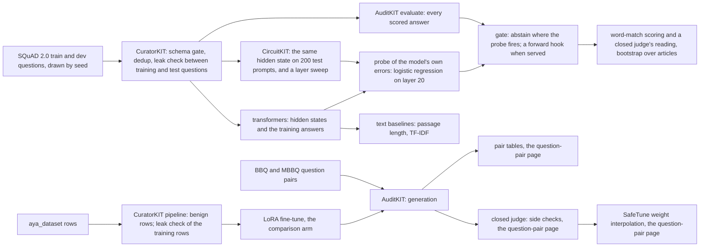

# Tiny Aya Global answers 97% of questions its passage cannot answer. A probe on its activations cuts wrong answers from 56% to 29% with no weight changes, 8 points better than one instruction line (36%); a LoRA fine-tune on the same 2,000 questions reaches 17%.

**One-line claim:** on 1,000 official SQuAD 2.0 dev questions, half of them unanswerable from their passage, Tiny Aya Global answers 485 of the 500 unanswerable ones. A logistic-regression probe on its layer-20 activations, trained on the model's own errors, makes it abstain where it fires: wrong answers go 560 → 286 (505 → 248 as read by a closed judge), and 401 of the 500 answerable questions are still answered. One instruction line in the prompt, with no probe, already gets 560 → 364, about 70% of that reduction; the probe is 7.8 points (95% CI over articles 3.89 to 11.9, p = 0.008) better than it, one wording against one probe. A LoRA fine-tune on the probe's 2,000 training questions gets 560 → 174, 11.2 points (95% CI over articles 7.94 to 14.27) better than the probe gate, at the cost of a training run and changed weights. English only; one probe, one fine-tune, one seed each.

| On 1,000 SQuAD 2.0 dev questions, 500 of them unanswerable | Wrong answers | Wrong answers as read by a closed judge | Unanswerable questions answered, of 500 | Answerable questions still answered, of 500 | Of them with a gold answer |
|---|---|---|---|---|---|
| Base model | 560 (56.0%) | 505 (50.5%) | 485 | 497 | 425 |
| Abstaining on every question | 500 (50.0%) | 500 (50.0%) | 0 | 0 | 0 |
| One instruction line in the prompt, no probe | 364 (36.4%) | 335 (33.5%) | 201 | 378 | 337 |
| **Probe on the activations as the gate** | 286 (28.6%) | 248 (24.8%) | 140 | 401 | 354 |
| Probe gate, else the instructed answer (exploratory) | 276 (27.6%) | 256 (25.6%) | 68 | 320 | 292 |
| LoRA fine-tune on the probe's 2,000 training questions | 174 (17.4%) | 155 (15.5%) | 70 | 431 | 396 |

*Wrong: an unanswerable question answered, or an answerable one answered incorrectly or abstained on. Word match is the rule set in advance; the judge's reading, the instruction line and the last two rows were added after the main result, and the row with the instructed answer is exploratory. Probe against base model: -27.4 points (95% CI over articles -32.3 to -22.8); probe against the instruction line: 7.8 points (95% CI over articles 3.89 to 11.9, p = 0.008) better. The fine-tune has fewer wrong answers than the probe gate (174 against 286; -11.2 points, 95% CI over articles -14.27 to -7.94; as the judge reads the answers 155 against 248, -9.3 points, 95% CI over articles -11.86 to -6.52) and keeps more answerable questions (431 against 401); it is the supervised reference: it costs a training run, changes the weights, was trained on labelled questions of the same dataset and format with the abstention sentence the word-match rule recognises, and is tested in distribution only. The probe leads here because it is the method the problem statement asks for, changes no weight and runs on a CPU. Labels used: the instruction line none; the probe the model's own errors on 2,000 train questions, its threshold set on train data; the fine-tune the gold answers of the same 2,000.*

## Tracks + problem statements covered

- Track 2b: Hallucination detection and abstention (main; findings 1 to 3)

Not claimed: Track 2a "Multilingual and code-mixed safety", Track 2b "Safety-preserving fine-tuning" and Track 2b "Repairing safety drift without retraining". The question-pair results are secondary evidence and the fine-tune's results on harmful requests are side checks; both are in the question-pair page.

## Content warning

The side checks use red-teaming prompts, and the published datasets hold harmful requests and answers. This article quotes no harmful text.

## Abstract

- **The failure.** On 1,000 official SQuAD 2.0 dev questions, 500 of which their passage cannot answer, the base model answers 485 of those 500: an answer with no ground in the given text. It is wrong on 560 of 1,000.
- **The probe.** A logistic regression on the layer-20 hidden state, trained on the model's own errors on 2,000 train questions and scored once. Abstaining where it fires takes wrong answers to 286 (-27.4 points, 95% CI over articles -32.3 to -22.8); 401 of 500 answerable questions are still answered. On a second sample of 1,000 questions, mostly on the same passages: 575 → 315 (-26.0 points, 95% CI over articles -29.93 to -22.45).
- **What a deployer would do first.** One instruction line in the prompt, with no probe, gets 560 → 364: about 70% of the reduction for free. The probe is 7.8 points (95% CI over articles 3.89 to 11.9, p = 0.008) better. Combining the two (exploratory) does not lower wrong answers beyond the probe alone.
- **What a fine-tune does.** A LoRA fine-tune on the probe's own 2,000 training questions is wrong on 174 of 1,000 (-11.2 points, 95% CI over articles -14.27 to -7.94 against the probe gate) and still answers 431 of 500 answerable questions: better than the probe on both counts. It costs a training run and changes the weights, and it was trained on questions of the same dataset and format, with the abstention sentence the scoring rule recognises; where the weights must stay fixed, the probe gate gets about 71% of the fine-tune's reduction (274 of 386 fewer wrong answers).
- **Not a text cue, and more than output confidence.** AUC against the model's error: the probe 0.8246, passage length 0.4978, TF-IDF 0.5545; on the second sample the model's own output confidence 0.6951 at best, the probe 0.7853.
- **Three kits in the result.** CuratorKIT gates the questions, AuditKIT generates the scored answers, CircuitKIT reads the same hidden states (same probe decision on 200 of 200 prompts) and finds the same layer. Served through a forward hook, the gate gives the offline gate's answers.
- **What does not carry.** Probes trained on BBQ question pairs barely move SQuAD (560 → 502 and 549), and a fine-tune that removes the behaviour on pairs still answers 467 of the 500 unanswerable SQuAD questions and is wrong on 529 of 1,000.
- **Limits.** English only; one probe, one fine-tune, one seed each, one prompt wording; the errors it flags are mostly answered unanswerable questions.

## Headline before → after number

- Wrong answers on 1,000 SQuAD 2.0 dev questions, base model → base model with the probe: 560 → 286 (56.0% → 28.6%; -27.4 points, 95% CI over articles -32.3 to -22.8; 35 of 35 articles better); as read by a closed judge 505 → 248 (-25.7 points, 95% CI over articles -30.63 to -21.15).
- Against one instruction line in the prompt (364 wrong answers): the probe is 7.8 points (95% CI over articles 3.89 to 11.9, p = 0.008) better.
- Against a LoRA fine-tune on the probe's 2,000 training questions (174 wrong answers): the fine-tune is 11.2 points (95% CI over articles 7.94 to 14.27) better than the probe gate.

## Base model + method in one line

Tiny Aya Global (3.35B); a logistic-regression probe (scikit-learn) on its layer-20 hidden state at the last prompt token, trained on the model's own errors on official SQuAD 2.0 train questions; a gate that abstains where the probe fires, checked served through a forward hook; text-only baselines (passage length, TF-IDF); answers generated through AuditKIT, questions checked with CuratorKIT. Secondary: question pairs from BBQ and MBBQ and a LoRA fine-tune (TRL).

## For judges: one minute

> **Question.** Does a probe on Tiny Aya Global's (3.35B) activations flag the answers it is about to get wrong, so that abstaining there leaves fewer wrong answers while it still answers most answerable questions, does it beat what a prompt can do, and how far is it from a fine-tune on the same questions?
>
> **Answer in four numbers.** (1) Wrong answers on 1,000 SQuAD 2.0 dev questions: 560 → 286. (2) One instruction line in the prompt gets 364 for free; the probe is 7.8 points better than it. (3) Answerable questions still answered: 401 of 500. (4) A LoRA fine-tune on the probe's 2,000 training questions: 174 wrong, 431 of 500 still answered; it changes the weights.
>
> **Still open.** English only; one probe, one seed (a second sample of questions, mostly on the same passages, gives 575 → 315); one prompt wording, combined with the probe only as an exploratory computation; word-match scoring (a closed judge's labels give 505 → 248); the errors it flags are mostly answered unanswerable questions.
>
> **Cost.** The probe: a workstation CPU, no GPU job and no weight change. The fine-tune: one GPU training job.
>
> **Where to click.** [Results Space](https://huggingface.co/spaces/vincentnkq/tiny-aya-safety-map) (the main table, the probe beside two text-only scores, risk against coverage; no model runs); [notebook](https://github.com/vincentni/tiny-aya-safety-drift-map/blob/main/notebooks/reproduce_tables.ipynb) (recounts the main table from one row per question, no GPU).

## Problem statement and approach

The study answers one Track 2b problem statement, quoted as published:

> **Hallucination detection and abstention.** "Train probes on internal activations to flag likely hallucinations, so the model abstains or triggers retrieval when a probe fires. Show fewer wrong answers while it still answers most questions."

| The statement asks | What is done, on which data | Where |
|---|---|---|
| "Train probes on internal activations" | a logistic regression on the layer-20 hidden state at the last prompt token; 2,000 official SQuAD 2.0 train questions, split by article into 1,599 to fit and 401 to choose layer, C and threshold | finding 2 |
| "on internal activations", read a second way | the same layer-20 hidden state read through CircuitKIT gives the frozen probe the same decision on 200 of 200 test prompts, and CircuitKIT's own linear probe peaks at the same layer | finding 2 |
| "to flag likely hallucinations" | the label is the model's own error on each question: an unanswerable question answered, or an answerable one answered without a gold answer | finding 2 |
| "so the model abstains or triggers retrieval when a probe fires" | it abstains: a question the probe fires on gets a fixed abstention. Served through a forward hook during generation, the gate gives the offline gate's answers on 100 of 100 dev prompts. Retrieval is not used | finding 3 |
| "Show fewer wrong answers" | 560 → 286 of 1,000 on the dev sample, scored once | findings 1 and 2 |
| "while it still answers most questions" | 401 of the 500 answerable questions (80.2%) are still answered; it answers 541 of all 1,000 questions, 500 of which should not be answered | finding 2 |

A hallucination here is an answer to a question the passage cannot answer: an answer with no ground in the given text. The questions are official SQuAD 2.0. Question pairs from BBQ and MBBQ, a second kind of unanswerable question, are secondary evidence (finding 4); their data, method, tables and the fine-tune's side checks on harmful requests are in the [question-pair page](question-pairs.md).

### Why this problem / real use case

The use case is an assistant on a small multilingual model that answers questions from tickets, chats and documents which often do not hold the answer. Answering anyway is the failure: on SQuAD 2.0 the base model does it for 97% of the questions its passage cannot answer.

### Research questions or hypotheses

1. How often does the base model answer a question its passage cannot answer?
2. Does a probe on its activations predict its own errors beyond what the text alone predicts, and does abstaining where it fires leave fewer wrong answers while answerable questions are still answered?
3. Does the gate work inside a running model?
4. What carries from one kind of unanswerable question to another: a probe, a fine-tune?

### Pre-registered hypotheses

The design rules below were fixed in the experiment scripts before the first result. They are dated by local file times only, not by a third-party timestamp. The plan those scripts follow is a local file and is not among the public files.

The file times are in [section N of the question-pair page](question-pairs.md#n-method-detail-of-the-write-ups-main-result).

| Design rule | Outcome |
|---|---|
| The label: the model's own error on each question, read by word match | used as written; its limits are under Limitations |
| The grid: layers 4, 8, ..., 36; C from 0.0001 to 1, 5 values | 45 fits, all in the fit record |
| The selection: layer and C by dev AUC, the threshold by the dev true-positive rate minus the false-positive rate | layer 20 of 36, C 0.001, dev AUC 0.817, threshold 0.7 |
| The text baselines: passage length and TF-IDF, picked by the same rule | fitted once |
| The metrics: wrong answers, hallucinations, answerable questions still answered, coverage, risk, AUC against the model's error | all reported |
| The statistics: a percentile bootstrap over articles and an exact sign test over articles | as written |
| One probe, scored once on the test questions | scored once |

**Added after the main result was known**: the served check of the probe; then the judge's reading, the replication, the fine-tune on the test questions and the regeneration through AuditKIT; then the CuratorKIT gate, which drops no row; then two baselines, an instruction line in the prompt and the model's own confidence, a check of the hidden states through CircuitKIT, an exploratory combination of the probe with the instruction line, the LoRA fine-tune on the probe's 2,000 training questions, and the GPU check of the base model's answers.

**What a reader can check in the public files**: the fit record with the whole grid and the values chosen on dev, the frozen probe with the hash of its weights, the tables and the row files without text, and the package steps that fit and score again from stored inputs.

### Threat model

| | |
|---|---|
| Who triggers it | an ordinary user; no attacker is needed |
| Input | one user message: a passage, a question and "Answer in one short sentence." |
| What varies | whether the passage can answer the question |
| What is defended | abstaining when the passage does not hold the answer, while still answering when it does |
| Out of scope | jailbreak wrappers, prompt injection, multi-turn use, retrieval, long documents |

### Related work

The works this study builds on, one row each, are in [section N of the question-pair page](question-pairs.md#n-method-detail-of-the-write-ups-main-result).

What this study adds to them: on a small multilingual model, a probe of the model's own errors on SQuAD 2.0 used as an abstention gate, with text-only baselines and a served check, and two negative results: probes and a fine-tune trained on one kind of unanswerable question do not carry to another, and on question pairs a token count nearly matches a probe.

## Hackathon repos (kits) used

### CuratorKIT

| Repo | Version | Module | Symbols | What for |
|---|---|---|---|---|
| CuratorKIT | 0.1.22 | `src/driftmap/attribution/probe_curator.py` | `Pipeline`, `SchemaGate`, `ExactDeduplicator`, `MinHashDeduplicator` | main result: a gate in the probe's data path: schema gate, dedup and the leak check between the probe's training and test questions |
| CuratorKIT | 0.1.22 | `src/driftmap/data/curator.py` | `Pipeline`, `ProvenanceManifest`, `DatasetCardGenerator` | cleans the benign rows, 212 of which are in the training set; its schema gate and dedup steps run over all 1,412 training rows as a report |
| CuratorKIT | 0.1.22 | `src/driftmap/data/dedup.py` | `ExactDeduplicator`, `MinHashDeduplicator` | the leak check: no training row repeats, exactly or nearly, a test prompt |

### SafeTune

| Repo | Version | Module | Symbols | What for |
|---|---|---|---|---|
| SafeTune | 0.1.10 | `src/driftmap/repair/wiseft.py` | `WiseFTTrainer` | weight interpolation between the base model and a fine-tune that lost safety (the question-pair page) |

### AuditKIT

| Repo | Version | Module | Symbols | What for |
|---|---|---|---|---|
| AuditKIT | 1.1.3 | `src/driftmap/attribution/local_generate.py` | `evaluate`, `Sample` | main result: generation of every scored SQuAD answer, on a CPU |
| AuditKIT | 1.1.3 | `src/driftmap/gen/rows.py`, `src/driftmap/gen/adapters.py` | `evaluate`, `Sample`, `ChrF`, `GenerationAdapter` | generation for every arm and every side check, and chrF on the benign task |
| AuditKIT | 1.1.3 | `src/driftmap/table/stats.py` | `paired_bootstrap` | the paired difference in the tables of the question-pair page |

### CircuitKIT

| Repo | Version | Module | Symbols | What for |
|---|---|---|---|---|
| CircuitKIT | 0.2.4 | `tools/circuitkit/circuitkit_check.py` | `load_model`, `LinearProbe`, `ProbeTrainer` | main result: reads the hidden state the probe uses (`blocks.19.hook_resid_post`) on 200 test prompts, and sweeps the layers with its own linear probe |

### How the repos connect



In text, three kits are in the main result:

- **CuratorKIT** gates the questions: its schema gate, its dedup and the leak check between the probe's training and test questions. It drops nothing here: 2,000 of 2,000 training and 1,000 of 1,000 test questions pass.
- **AuditKIT** generates every scored answer, through `evaluate`. The 1,000 dev answers generated through AuditKIT's `evaluate` (`driftmap.attribution.local_generate`) equal the scored ones row for row in text, token count and stop reason, so the answers the headline and the judge's reading are scored on are AuditKIT's by identity.
- **CircuitKIT** reads the hidden state the probe uses and locates its layer: the frozen probe's decision is the same on 200 of 200 test prompts read through it, and its own linear probe peaks at layer 20. It is a verification on 200 of 1,000 prompts; the headline's states were read by transformers.
- **Plain transformers, scikit-learn and scipy**: the probe's fit, the text baselines, the statistics, and the answers to the 2,000 training questions that give the probe its labels.
- **SafeTune** appears only in the side checks of the question-pair page, which are not claimed.

The other rows of the kit tables above are secondary evidence (the question-pair page).

## Models and licenses

| Model | Role | License |
|---|---|---|
| `CohereLabs/tiny-aya-global` | base model | cc-by-nc-4.0 |
| `vincentnkq/tiny-aya-global-attribution-lora` | adapter of the attribution fine-tune; trained for one behaviour, not a general safety fix | cc-by-nc-4.0 |
| `vincentnkq/tiny-aya-global-squad-abstain-lora` | adapter of the fine-tune on the probe's 2,000 training questions, the comparison arm of the main result; a research artifact | cc-by-nc-4.0 |
| `vincentnkq/tiny-aya-global-drift-lora` | adapter of the benign fine-tune with the same settings (side checks) | cc-by-nc-4.0 |
| `vincentnkq/tiny-aya-global-drift-lora-nopre` | adapter of the overfit benign fine-tune (side checks; a research artifact) | cc-by-nc-4.0 |
| `vincentnkq/tiny-aya-global-repaired-nopre` | the overfit fine-tune after weight interpolation (side checks) | cc-by-nc-4.0 |
| `vincentnkq/tiny-aya-global-drift-GGUF` | the benign fine-tune as a q4_k_m file (side checks) | cc-by-nc-4.0 |
| `claude-sonnet-5-5` | the closed model: reader of the SQuAD answers in the scoring check; in the secondary sections reader of open answers, judge of the side checks, translator and checker of the items in the question-pair page | closed, no weights |

### Base Aya model

`CohereLabs/tiny-aya-global` at revision `af89d219b53e` (3.35B parameters, cc-by-nc-4.0), with its chat template as shipped and greedy decoding. On SQuAD it runs in float32 on a CPU, at most 48 new tokens; on the question pairs and the side checks as full bfloat16 weights on a GPU, at most 48 and 256 new tokens.

### Target / hardened model attacked

The base model under its served template, alone and gated by the SQuAD probe. In findings 4 and 5: the base model gated by the pair probes, and the attribution fine-tune. No externally hardened model was attacked.

### Closed-model baseline

None: no closed model answers the prompts. One reads the SQuAD answers in the scoring check, reads the open answers and judges the side checks, and translated and checked the items of the question-pair page; its prompts and labels are public.

## Datasets, benchmarks and licenses

### Source(s) of data

Datasets: why this one, how it was built.

| Dataset | What it is | Why this one | How it was built |
|---|---|---|---|
| First test sample, 1,000 questions | a seeded sample of an official set, the SQuAD 2.0 validation file | an official benchmark whose unanswerable questions were written by people to look answerable | passages under 250 words; articles in a seeded order; one question per passage; 500 unanswerable and 500 answerable; 35 articles |
| Second test sample, 1,000 questions | a seeded sample of the same file | to see whether the result hangs on one draw of questions | the same recipe with a seed of its own; none of the first sample's questions; 838 of 1,000 of its passages and all of its articles are the first sample's |
| The probe's training sample, 2,000 questions | a seeded sample of an official set, the SQuAD 2.0 train file | the probe needs this model's errors on questions of this kind, from articles the tests never use | the same recipe, 1,000 and 1,000, 442 articles; the label is the model's own error by the word-match rule set in advance; split by article into 1,599 and 401 for selection; every row passes the CuratorKIT gate |
| The judge's labels on the answers | constructed for this study | a second reading of the answers that does not rest on word matching | `claude-sonnet-5-5` answers two questions per answer, does it abstain and does it state a reference answer, seeing the passage, the question, the references and the answer, not the model, the word-match labels or the probe; it agrees with the error label on 937 of 1,000 |
| Question pairs and the sets built on them (secondary evidence) | official sets and sets constructed for this study | a second kind of unanswerable question | the same three columns for each set are in the question-pair page |

Licences and what is redistributed:

| Source | Use | License |
|---|---|---|
| `rajpurkar/squad_v2` at revision `3ffb306f725f`; `facebook/belebele` | the main test: 1,000 questions of the SQuAD 2.0 validation file, and 2,000 of its train file for the probe; a reading check on 240 Belebele questions and 200 SQuAD questions (the question-pair page) | cc-by-sa-4.0; no passage, question, gold answer or answer text is redistributed: rows are published by the datasets' own question ids with the scoring's labels. The Belebele answers, a letter or a letter name, are published as they are |
| BBQ (`nyu-mll/BBQ` on GitHub) and MBBQ (`Veranep/MBBQ` on GitHub) | the question pairs of the secondary evidence, in English, and in English, Spanish, Dutch and Turkish; MBBQ is used for evaluation only and none of its text is republished | cc-by-4.0 |

### Languages covered

English only for the main result. The secondary question pairs are in English, Spanish, Dutch and Turkish.

### Train / test splits, leak check

| Split | Size | Source |
|---|---|---|
| Leak check, SQuAD | no passage and no article is in both samples, by the draw's own count; CuratorKIT's cross-set check below | |
| Question pairs (secondary evidence) | BBQ's English test: 150 pairs never trained on. MBBQ: 150 pairs in each of English, Spanish, Dutch and Turkish. The pair probe is fitted on English BBQ items; splits and leak checks are in the question-pair page | BBQ; MBBQ |

Sampling is seeded; source revisions are pinned.

### Safety benchmark(s)

SQuAD 2.0's unanswerable questions, from the official validation file, are the benchmark of the main result. BBQ's ambiguous items with their answerable twins, from BBQ and MBBQ (Parrish et al., 2022; Neplenbroek et al., 2024a), are the secondary one.

### General capability benchmark(s)

The answerable questions of the same SQuAD sample: answered, and answered with a gold answer.

### CuratorKIT filtering

On the SQuAD questions of the main result CuratorKIT 0.1.22 is a gate in the data path: `driftmap.attribution.probe_curator` runs its schema gate, its dedup and the cross-set check (settings under Method), and the fit and the scoring read only the rows that pass. On these rows it drops nothing: 2,000 of 2,000 training questions and 1,000 of 1,000 test questions pass every check, and the training sample shares no id, passage, question or article with the test sample. The draw by article had already separated the sets; the gate is the check a reader can rerun. One limit: CuratorKIT's reader has no context field for a prompt without an output, so the passage sits inside `instruction` and the comparison between the sets runs through `cross_dedup`.

The fine-tune's training rows and their checks are in the question-pair page.

### Attack prompt set

| Prompt type | Source | Size | Languages |
|---|---|---|---|
| A passage and a question, half of them unanswerable from the passage (not an attack) | SQuAD 2.0 | 1,000 test; 2,000 for the probe | en |
| A who-question the text cannot answer, with three options (not an attack), and its answerable twin | MBBQ; BBQ | 150 pairs per language; 150 pairs | en, es, nl, tr; en |
| Jailbreak wrappers, prompt injection, encoding tricks | not used | | |

### Over-refusal test set

None in the main result: the price of the gate is measured on answerable questions. XSTest serves the side checks of the question-pair page.

## Metrics, and why these

### List of metrics

| Metric | Definition | Better |
|---|---|---|
| Hallucination | an unanswerable question that is answered, not abstained on | lower |
| Wrong answers | hallucinations, answerable questions whose answer holds no gold answer, and answerable questions the gate abstains on, of all questions | lower |
| Answerable still answered | answerable questions that get an answer | higher |
| Coverage and risk | the share of questions answered; the share of the answered ones that are wrong | |
| AUC against the model's error | how often a score ranks a question the model gets wrong above one it gets right | higher |
| Scoring on SQuAD | by word match: an answer abstains when it carries an abstention wording, and is correct when it contains a gold answer, case aside | |
| Wrong answers, question pairs | rows whose answer is not the right option, of all rows, open questions and answerable twins; an answer that names no option counts | lower |

### Metrics for what should not get worse

On SQuAD: answerable questions still answered, and answered with a gold answer.

### Checking the automatic judge

SQuAD answers are scored by word match, with no model. The closed model then read all 1,000 base answers blind (finding 2): it agrees with the error label on 937 of 1,000 (kappa 0.87), and the headline is given under both. Its reading of SQuAD answers is not checked against human labels. Letter answers on the question pairs are scored by rule, with no model.

### Attack success rate (ASR) and cost-to-break

No attack is involved: the rate that counts is how often an ordinary question the passage cannot answer gets an answer. Cost-to-break is not measured.

## Method / experiments

### Training or attack setup, hyperparameters

#### CuratorKIT

| Step | Setting |
|---|---|
| The probe's SQuAD questions, CuratorKIT 0.1.22 | the schema gate (`instruction` required, 1 to 2,048 tokens) on each file; exact dedup and MinHash dedup of the prompt on the training sample (threshold 0.85, 3-grams, 128 permutations); `cross_dedup` of the training sample against the test sample, on the passage and again on the question |

#### SafeTune

| Step | Setting |
|---|---|
| Repair of the overfit benign fine-tune (the question-pair page), SafeTune 0.1.10 | `WiseFTTrainer`; alphas 0.25, 0.5 and 0.75 screened, 0.25 applied; alpha is the weight of the base model |

#### AuditKIT

| Step | Setting |
|---|---|
| Scored SQuAD answers, AuditKIT 1.1.3 | `driftmap.attribution.local_generate`: `evaluate` over a raw-prompt adapter, the served template, greedy, float32 on a CPU, at most 48 new tokens; the second sample's answers and the fine-tune's answers to the test questions are generated the same way |

#### CircuitKIT

| Step | Setting |
|---|---|
| Check of the hidden states, CircuitKIT 0.2.4 with TransformerLens 3.8.0 | `load_model` from a local folder, per-head hook points off; `blocks.19.hook_resid_post` at the last prompt token, one unpadded prompt at a time against the stored run's padded batches, every fifth test question. Layer sweep: `LinearProbe` trained by `ProbeTrainer` at its defaults on the stored training states, the study's split and label. An environment of its own (`tools/circuitkit/requirements-circuitkit.txt`) |

#### Outside the kits

The settings of the probe, its baselines, the served gate, the scoring and the checks are in [section N of the question-pair page](question-pairs.md#n-method-detail-of-the-write-ups-main-result).

### Seeds

| | |
|---|---|
| Data split and sampling | seed 20261114 for the question pairs and the other two datasets, 20261102 for the side-check prompts |
| SQuAD probe | one probe; draw seeds `20261114-squad-probe-dev` and `20261114-squad-probe-train`; split and bootstrap seed 20261114 |
| Generation | greedy |

### Ablations

| Ablation | Held fixed | Where |
|---|---|---|
| Activations or text only: the probe, passage length, TF-IDF | questions, label, selection rule | finding 2 |
| A probe or an instruction line in the prompt | questions, base model, scoring | finding 2 |
| A probe or the model's own confidence as the gate | questions of the second sample, base model, number of questions answered | finding 2 |
| A probe trained in domain or on question pairs | test questions | finding 4 |
| The gate served or computed offline | probe, prompts | finding 3 |
| The pair probe or the fine-tune | base model, items | the question-pair page |

## Results

### Same model before vs after (table)

Served template; the same 1,000 questions for every row. The table under the one-line claim gives wrong answers, hallucinations and answerable questions still answered; the rest, by word match and by the judge:

| Word match / judge | Answerable questions answered correctly, of 500 | Questions answered, of 1,000 | Wrong among the answered |
|---|---|---|---|
| Base model | 425 / 477 | 982 / 982 | 57.0% / 51.4% |
| One instruction line in the prompt, no probe | 337 / 365 | 579 / 585 | 43.9% / 37.6% |
| Probe on the activations as the gate | 354 / 390 | 541 / 541 | 34.9% / 27.9% |
| Probe gate, else the instructed answer (exploratory) | 292 / 312 | 388 / 394 | 26.8% / 20.8% |
| LoRA fine-tune on the probe's 2,000 training questions | 396 / 415 | 501 / 501 | 21.2% / 17.2% |

### Safety + general results side by side

The gate's price is paid on the answerable half of the same questions: 497 → 401 answered, 425 → 354 with a gold answer. The fine-tune's safety and task side checks are in the question-pair page.

### Confidence intervals and significance tests

The change in wrong answers on SQuAD carries a percentile bootstrap interval over the 35 articles, since questions of one article are not independent, and an exact sign test over articles. AUC differences carry a bootstrap interval over articles. It is the one confirmatory test of the study. On the question pairs changes are paired by base item (the question-pair page); per-language rows are exploratory.

### Findings as named subsections

#### 1. The base model answers what its passage cannot answer

1,000 questions of the official SQuAD 2.0 validation file, each on its own passage of under 250 words, from 35 articles: 500 unanswerable from the passage, 500 answerable. The prompt is the passage, the question and "Answer in one short sentence." under the served template.

| Base model | Questions |
|---|---|
| Unanswerable, answered | 485 of 500 |
| Unanswerable, abstained on | 15 of 500 |
| Answerable, a gold answer in the reply | 425 of 500 |
| Answerable, no gold answer in the reply | 75 of 500 |
| Answerable, the reply worded as an abstention; each holds a gold answer and counts as right | 3 of 500 |
| Wrong answers | 560 of 1,000 |

**It answers 97% of the questions it should not.** Of the 982 questions it answers, 57.0% are wrong.

#### 2. A probe of the model's own errors cuts them, and the text alone does not predict them

The label is the model's own error on each of 2,000 train questions (1,240 wrong). One standardisation and logistic regression per layer and C is fitted on 1,599 of them, and one is chosen on the other 401, from articles the fit never saw: layer 20 of 36, C 0.001, dev AUC 0.817, threshold 0.7. It is scored once on the 1,000 dev questions. Where it fires, the answer is an abstention.

**Fewer wrong answers.** 560 → 286 (-27.4 points, 95% CI over articles -32.3 to -22.8; 35 of 35 articles better, sign test p < 0.001): 345 questions go from wrong to right and 71 from right to wrong. Unanswerable questions answered fall 485 → 140.

**It still answers most answerable questions.** 401 of 500 (80.2%), 354 with a gold answer; the base model answers 497 and 425. Over all 1,000 questions it answers 541: half of them should not be answered, so coverage near 50% is the bound.

**A closed judge's reading agrees.** The closed model read all 1,000 base answers without the word-match labels, the model's name or the probe (agreement with the rules: Appendix A); word match marks 55 correct answers to answerable questions as wrong. With the probe unchanged, wrong answers under its labels go 505 → 248 (-25.7 points, 95% CI over articles -30.63 to -21.15; 35 of 35 articles better). The gate's price is larger under the judge, 477 → 390 answerable questions answered correctly, and the probe's AUC against the judge's error label is 0.8326.

**It holds on a second sample of questions.** A second draw of 1,000 questions from the same validation file, none of them in the first sample, is scored once with the frozen probe. It is a second sample of questions, mostly on the same passages (838 of 1,000 shared, and the same 35 articles), as the design said in advance. Wrong answers go 575 → 315 (-26.0 points, 95% CI over articles -29.93 to -22.45), and 395 of 500 answerable questions are still answered; the probe's AUC against the model's error is lower there, 0.7853. What this shows: the result does not hang on one draw of questions, and the probe never saw an article of either sample. What it does not show: an independent sample of text. Both samples come from the same 35 articles, which is why the interval over both together is no narrower.

| Base model → base model + probe | First sample, 1,000 questions | Second sample, 1,000 questions | Both, 2,000 questions |
|---|---|---|---|
| Wrong answers | 560 → 286 | 575 → 315 | 1,135 → 601 |
| Change in points (95% CI over articles) | -27.4 (-32.3 to -22.8) | -26.0 (-29.93 to -22.45) | -26.7 (-30.82 to -23.0) |
| Wrong answers as read by the judge | 505 → 248 | 523 → 277 | 1,028 → 525 |
| Change in points as read by the judge (95% CI over articles) | -25.7 (-30.63 to -21.15) | -24.6 (-28.79 to -20.78) | -25.15 (-29.37 to -21.37) |
| Answerable questions still answered | 497 → 401 | 498 → 395 | 995 → 796 |
| Probe AUC against the model's error | 0.8246 | 0.7853 | 0.8055 |

**The activations carry what the text does not.**

| Alternative | Sample | AUC against the model's error | Wrong answers | Answerable questions still answered, of 500 |
|---|---|---|---|---|
| Base model, no gate | first | | 560 | 497 |
| Probe on layer 20 as the gate | first | 0.8246 | 286 | 401 |
| Passage length as the gate | first | 0.4978 | 500: it fires on every question | 0 |
| TF-IDF of the prompt as the gate | first | 0.5545 | 500: it fires on every question | 0 |
| One instruction line in the prompt, no probe | first | not a score | 364 | 378 |
| Probe gate, else the instructed answer (exploratory) | first | not a score | 276 | 320 |
| LoRA fine-tune on the probe's 2,000 training questions | first | not a score | 174 | 431 |
| Base model, no gate | second | | 575 | 498 |
| Probe on layer 20 as the gate | second | 0.7853 | 315 | 395 |
| Mean log-probability of the answer as the gate, at the probe's coverage | second | 0.6951 | 411 | 339 |
| Probability of the answer's first token as the gate, at the probe's coverage | second | 0.5578 | 488 | 305 |
| LoRA fine-tune on the probe's 2,000 training questions | second | not a score | 188 | 424 |

The probe's AUC is 0.3269 (95% CI 0.2779 to 0.3806) above passage length and 0.2701 (95% CI 0.2250 to 0.3205) above TF-IDF. The two text gates fire on every question, which is abstaining on everything: 500 wrong of 1,000.

**One instruction line in the prompt gets about 70% of the reduction, and the probe is moderately better.** With the line "If the text does not give enough information to answer, say that it cannot be determined." added to the prompt and no probe, the base model is wrong on 364 of the 1,000 questions (-19.6 points, 95% CI over articles -24.11 to -15.47; 196 of the 274 wrong answers the probe removes), 335 as the judge reads the answers. The probe's gate is ahead of it by 7.8 points (95% CI over articles 3.89 to 11.9, p = 0.008), and by 8.7 points (95% CI over articles 4.37 to 13.05, p = 0.043) for the judge. One wording was fixed before the run and tried once.

**Combining the two does not lower wrong answers further (exploratory).** A two-pass computation, added after the instruction's numbers were known: the probe's gate on the plain prompt, otherwise the instructed model's answer; the probe is not refitted and its threshold not moved. Wrong answers are 276 against the probe's 286 (-1.0 points, 95% CI over articles -3.57 to +1.54), and 256 against 248 for the judge (+0.8, -1.91 to +3.47): no difference. It is another operating point, 68 unanswerable questions answered and 326 of 500 answerable ones for the judge, so by the statement's criterion the probe alone is the better point. Whether the combination helps at equal coverage is not shown.

**The hidden state carries what the model's output probabilities do not show.** On the second sample the model's own confidence in its stored answer is used as the gate, at the probe's coverage, since no threshold is fitted for it. The mean log-probability of the answer's tokens predicts the model's error with AUC 0.6951 and leaves 411 wrong answers (385 for the judge); the probe 0.7853 and 315 (277). The probe's AUC is 0.0902 above it (95% CI over articles 0.0577 to 0.1227). The probability of the answer's first token is near chance, 0.5578: an invented answer to an unanswerable question starts as confidently as a right one.

**CircuitKIT reads the same states and finds the same layer.** The headline's hidden states were read by transformers. Loaded a second time through CircuitKIT 0.2.4, the base model gives the frozen probe the same decision on 200 of 200 test prompts, every fifth one (88 fired both ways; largest probability difference 1.6e-06). A layer sweep with CircuitKIT's own linear probe on the stored training states peaks at layer 20 too: dev AUC 0.815 against the study's 0.817 (Appendix A).

**It is close to an answerability detector.** Its AUC against "the passage cannot answer the question" is 0.8534, above its 0.8246 against the model's error: trained on an error label, it mostly learns which questions are unanswerable.

**Risk against coverage.** At the threshold chosen on dev the gated model answers 54.1% of the questions with risk 34.9%; the curve over thresholds is in [section M of the question-pair page](question-pairs.md#m-the-squad-probe-of-the-write-up-the-judges-instruction-and-the-gate-at-each-threshold).

**Where it stops paying.** The gate fixes 345 of the 500 unanswerable questions and breaks 71 of the 500 answerable ones (344 and 87 as read by the judge). At these rates it cuts wrong answers only where more than 17.1% of the questions are unanswerable (20.2% by the judge's reading); here half are.

#### 3. Served through a forward hook, the gate gives the same answers

On 100 of the dev questions, every tenth of each half, the probe was served inside the running model. A forward hook on block 20 reads the last prompt token during the prompt pass and applies the probe; where it fires, a logits processor forces the sentence "It cannot be determined from the text." and the end of the sequence.

**The served answers equal the offline gate's on 100 of 100 prompts**: the same firing decision on all of them (47 fired), the abstention sentence on those 47, the stored answer's text on the other 53. On this sample wrong answers go 56 → 32 of 100. The same hook with the probe of the question pairs gives the offline gate's answers on 180 of 180 pair prompts. The check was added at 03:55 UTC, after the main numbers were known.

#### 4. What does not carry

Two probes and a fine-tune trained on BBQ question pairs barely move SQuAD (560 → 502 and 549 for the probes, 529 for the fine-tune), and on the pairs a count of context tokens nearly matches the pair probe. The table and the text are in [section N of the question-pair page](question-pairs.md#n-method-detail-of-the-write-ups-main-result).

#### 5. What training buys

A LoRA fine-tune on 1,412 English rows of question pairs ($0.49) removes the behaviour on pairs: a person is named in 358 → 8 of 600 MBBQ cases, and it beats the pair probe on every pair set (11 of 300 and 111 of 900 wrong; the question-pair page). It carries very little to SQuAD. On the same 1,000 test questions the fine-tune abstains on 33 of the 500 unanswerable ones (base model 15) and is wrong on 529, against the base model's 560 (-3.1 points, 95% CI over articles -4.81 to -1.47, p = 0.009). As the judge reads the answers it is 495 against 505, not distinguishable from no change (-1.0 points, 95% CI over articles -2.57 to +0.4, p = 0.648): the word-match gain comes mostly from the gold-answer rule, which misses fewer of the fine-tune's shorter answers. The gated base model is wrong on 286. The two methods are complementary by benchmark and neither transfers: the fine-tune wins on question pairs (11 wrong of 300 against the probe gate's 33), the probe on SQuAD.

**Training on the task's own questions is what makes the difference.** A second LoRA fine-tune is trained on the probe's own 2,000 training questions: the first gold answer for an answerable question, one fixed abstention sentence for an unanswerable one. On the 1,000 test questions it is wrong on 174 (-38.6 points, 95% CI over articles -42.92 to -34.34 against the base model; -11.2 points, 95% CI over articles -14.27 to -7.94 against the probe gate, 28 of 35 articles better and 4 worse; as the judge reads the answers 155 against 248, -9.3 points, 95% CI over articles -11.86 to -6.52). It answers 70 of the 500 unanswerable questions (probe gate 140) and 431 of the 500 answerable ones (401), 396 with a gold answer (354). On the second sample it is wrong on 188 against the probe gate's 315 (-12.7 points, 95% CI over articles -16.05 to -9.58). The fine-tune on question pairs is wrong on 529: the same method, trained on another kind of question.

Three things qualify the comparison with the probe. The fine-tune costs a training run and changes the weights; the probe changes none and runs on a CPU. Its training questions come from the same dataset and format as the test, though from other articles. And it abstains with the one sentence it was trained on (499 of its 1,000 answers), which the scoring rule recognises. It is the supervised reference, tested in distribution only: it has no test on another kind of unanswerable question. The fine-tune's answers come from a GPU job and the base model's stored answers from a CPU run; the base model's answers from the same GPU job equal the stored ones on 871 of 1,000 questions of the first sample and 879 of 1,000 of the second (text, token count and stop reason); the error label differs on 3 rows of the first sample (base model 560 wrong answers stored, 559 on the job) and on 5 of the second (575 and 572). The tables keep the stored answers, whose hidden states the probe reads. The fine-tune's training rows, prompts and raw answers hold SQuAD text and are not republished: the public files carry ids, labels and scores only, and the questions are rebuilt from the official SQuAD 2.0 files by id. Where the weights must stay fixed, the probe gate gets about 71% of the fine-tune's reduction (274 of 386 fewer wrong answers).

| On the 1,000 test questions | Base model | Base model + probe | Fine-tune on question pairs | Fine-tune on the probe's training questions |
|---|---|---|---|---|
| Wrong answers | 560 | 286 | 529 | 174 |
| Wrong answers as read by the judge | 505 | 248 | 495 | 155 |
| Unanswerable questions answered, of 500 | 485 | 140 | 467 | 70 |
| Answerable questions answered correctly, of 500 | 425 | 354 | 438 | 396 |

### What didn't work (negative results)

| Tried | Result |
|---|---|
| Probes trained on BBQ pairs, on SQuAD | 560 → 502 and 549 wrong answers, against 286 for the probe trained on SQuAD |
| Passage length and TF-IDF as predictors of the model's error on SQuAD | AUC 0.4978 and 0.5545; no threshold that gates |
| The pair probe as evidence of an internal signal | a count of context tokens reaches 41 of 300 and 194 of 900 wrong, against the probe's 33 and 169 |
| The SQuAD probe on answerable questions | it fires on 97 of 500; 71 questions go from right to wrong, and answers with a gold answer fall 425 → 354 |
| The fine-tune on unanswerable questions of another kind (SQuAD 2.0) | abstains on 33 of 500, against the base model's 15; wrong on 529 of 1,000, against 560, and on 495 against 505 as the judge reads the answers |

### Sample inputs and outputs

SQuAD's passages, questions and answers are not quoted here or in the published files, which name each question by the dataset's own id. A gated answer is one fixed sentence: "It cannot be determined from the text." A question pair with its stored answers is quoted in the question-pair page.

### Results on the quantized / deployed model

The probe leaves the base model's weights as they are, at full precision, and no model is deployed. No quantized model is part of the main result.

## Cost / ROI

### Compute used

The probe result needs no GPU: generation, hidden states and fits run on a workstation CPU. The fine-tune comparison row is a GPU job. Every GPU step is a Hugging Face Job on one L4 ($0.80 per hour) logged in a cost ledger.

| Stage | Jobs | Minutes | Cost |
|---|---|---|---|
| The probes: generation, activations and fits on a workstation CPU, no job | 0 | | $0 |
| Attribution fine-tune, the comparison arm | 1 | 37 | $0.49 |
| LoRA fine-tune on the probe's 2,000 training questions: training (59 minutes, $0.79), its answers (12, $0.16) and the base model's answers on the same GPU (11, $0.15) | 3 | 82 | $1.10 |
| Total, ledger | 45 | 1,017 | $13.48 |

The closed model's API cost is excluded.

### Cost per 1k replies vs API

| | |
|---|---|
| Closed-model price | none quoted, since no closed model answers the prompts |
| One pass over the 1,000 SQuAD questions | answers and hidden states in 29 minutes on a workstation CPU (6 processes of 10 threads), no GPU; the gate adds one logistic regression per prompt |

## Limitations

### Known weaknesses

| Limit | What it means here |
|---|---|
| English only | the main result is on SQuAD 2.0 in English; other languages appear only on the secondary question pairs |
| One probe, one seed | one layer, one C and one threshold, chosen once on dev, and the probe is fitted once. The replication is on a second sample of questions, not an independent sample of text: 838 of 1,000 of its passages and all of its articles are those of the first sample (finding 2) |
| Word-match scoring | the headline is scored by word match: abstention by wording, correctness by a gold answer in the reply, so a gold answer inside a wrong sentence counts as right and a correct answer in other words as wrong. A closed judge disagrees with the error label on 63 of 1,000 answers; under its labels the result is 505 → 248 (finding 2). The judge is one closed model, not checked against human labels on this task |
| What the probe detects | the model's errors on SQuAD are mostly answered unanswerable questions (485 of 560 by word match, 482 of 505 for the judge), so the probe is not shown to detect wrong answers to answerable questions; its AUC against "unanswerable" (0.8534) is above its AUC against the model's error (0.8246) |
| Where the gate pays | only where more than 17.1% of the questions are unanswerable (20.2% by the judge's reading; finding 2); here half are, which also bounds coverage over all questions near 50% |
| A prompt instruction is a strong baseline | one line in the prompt takes wrong answers to 364 with no probe; the probe's margin over it is 7.8 points (95% CI over articles 3.89 to 11.9, p = 0.008), one wording against one probe on 35 articles. The two are combined only as an exploratory two-pass computation; the probe was not read on the instructed prompt |
| The fine-tune is a supervised reference, tested in distribution only | one training run and one seed; its training questions share the test's dataset and format, and it abstains with the sentence the word-match rule recognises; it has no test on another kind of unanswerable question, and the fine-tune on question pairs did not carry over (529 wrong). The fine-tune's answers come from a GPU job and the base model's stored answers from a CPU run; the base model's answers from the same GPU job equal the stored ones on 871 of 1,000 questions of the first sample and 879 of 1,000 of the second (text, token count and stop reason); the error label differs on 3 rows of the first sample (base model 560 wrong answers stored, 559 on the job) and on 5 of the second (575 and 572). The tables keep the stored answers, whose hidden states the probe reads. |
| Two confidence scores out of many | the probability of the answer's first token and the mean log-probability of its tokens; no sampling-based or verbalised confidence was tried, and no threshold is fitted for them |
| The CircuitKIT check | 200 of 1,000 prompts, taken by position; an environment of its own, outside the project's lock; the sweep's states were read by transformers |
| Short passages | every passage is under 250 words |
| The served gate | the headline is computed offline from stored answers and activations; served, the gate is checked on 100 of the 1,000 questions (finding 3), and its latency is not measured |

### Dual-use / ethics

| Risk | What was done |
|---|---|
| The datasets hold harmful requests and harmful answers | they come from an existing public red-teaming set and are published under a content warning; the results page withholds the text of answers judged harmful |

### Responsible disclosure

No embargoed finding: the model, SQuAD 2.0, BBQ and the red-teaming prompts are public. Every label is published, and every answer except those to SQuAD questions, which quote their passages.

## With more credits

### Planned approach

| Step | Estimated cost |
|---|---|
| Probes fitted on mixed kinds of unanswerable questions and tested on a kind held out of the fit; the served gate's latency; SQuAD-form questions in other languages | $1 on one L4 |
| Train on mixed families of unanswerable questions (who-did-it pairs and reading questions with no answer in the passage), tested on a family held out of training | $2 on one L4 |

### Expected before / after

Forecasts; none is a result.

| Question | Now | Expected with more credits |
|---|---|---|
| Does a probe carry to another kind of unanswerable question? | probes trained on pairs do not carry to SQuAD | a probe trained on mixed kinds carries in part to a held-out kind |
| Does abstention carry to other unanswerable questions? | barely: on SQuAD 2.0 the fine-tune still answers 467 of 500 unanswerable questions | with mixed training families, abstention on a held-out family well above that, and some loss on answerable questions |

## Artifacts

### HF datasets collection

https://huggingface.co/collections/vincentnkq/tiny-aya-safety-drift-map-data

| Dataset | Holds |
|---|---|
| `vincentnkq/aya-redteaming-6lang-eval` | the question pairs (`choice/`: BBQ's English test and the translated items of the question-pair page; `mbbq/manifest.json`: the manifest of the MBBQ draw), the training rows (`sft_train_defense/`), the side-check prompts and every judge label |
| `vincentnkq/safety-drift-map-responses` | the stored answers to the harmful-request, benign and BBQ prompts of every arm and checkpoint; answers to SQuAD and MBBQ questions are not republished (ids, letters and labels only, in the tables) |
| `vincentnkq/safety-drift-map-results` | the probe tables with their row files without text, under `tables/`: `probe-squad.json` (it carries the counts of the CuratorKIT gate), `probe-squad-judge.json`, `probe-squad-served.json`, `probe-squad-identity.json`, `probe-squad-replication.json`, `probe-squad-pooled.json`, `probe-squad-fine-tune.json`, `probe-squad-trained.json`, `probe-squad-trained-replication.json`, `probe-squad-job-identity.json`, `probe-squad-prompt.json`, `probe-squad-prompt-probe.json`, `probe-squad-confidence.json`, `probe-squad-circuitkit.json`, `probe-bbq.json`, `probe-baselines.json` and `probe-served.json`, each with a `.md`, and row files such as `probe-squad-answers-in-domain.jsonl`; the frozen probes (`probe.safetensors`, `probe.json`) with their fit records, under `probe/`; the choice tables (`tables/choice-defense.json`, `tables/choice-mbbq-defense.json`); the MBBQ items and answers by row id, without text (`mbbq/`); the checks (`checks/`); the tables of the side checks, run records and the cost ledger |

### HF models collection

https://huggingface.co/collections/vincentnkq/tiny-aya-safety-drift-map-models

The model repositories of the table under "Models and licenses".

### GitHub repo

https://github.com/vincentni/tiny-aya-safety-drift-map, with the notebook that recounts the main table from one row per question, and the secondary tables from the stored answers: [`notebooks/reproduce_tables.ipynb`](https://github.com/vincentni/tiny-aya-safety-drift-map/blob/main/notebooks/reproduce_tables.ipynb).

### Demo / Space

https://huggingface.co/spaces/vincentnkq/tiny-aya-safety-map: a static results page: the probe on SQuAD 2.0 (the main table with the instruction line, the judge's reading, a second sample, the probe beside a fine-tune and the model's own confidence, the text-only scores, risk against coverage, probes fitted on question pairs), then the secondary evidence.

## Documentation and reproduction

### Environment requirements

| For | Needs |
|---|---|
| The tests | Python 3.12 and uv; no GPU, no token, no network |
| The notebook | a CPU; `pip install huggingface_hub pandas scipy matplotlib` |
| The pipeline | a Hugging Face account with access to the gated base model and to Jobs (one L4, 24 GB), and a route to the closed model |

### Repo layout and run instructions

| Path | What it holds |
|---|---|
| `src/driftmap/` | the package: `data`, `gen` (AuditKIT generation), `judge`, `attribution` (the question pairs, the activation probe, translation, CuratorKIT report, reading of open answers, the check on two other datasets), `table` (the probe table, the choice table, rates, paired statistics, figures), `repair` (SafeTune), `quant`, `publish`, `jobkit`, `core`, `cli.py` |
| `jobs/`, `tests/` | the entry points a Hugging Face Job runs; offline unit tests |
| `tools/circuitkit/` | the CircuitKIT check of the probe's hidden states, with the requirements of its own environment |
| `notebooks/reproduce_tables.ipynb` | recounts the SQuAD probe's table from its row file without text, then the two choice tables and the side-check tables of the secondary evidence |
| `space/` | the static results page and `build_data.py`, which builds its data |
| `docs/` | this article, the abstract, the [detail page](harmful-requests.md), the figures and the [commands reference](commands.md) |

```bash
uv python install 3.12 && uv sync --frozen
uv run pytest -q -m "not smoke"
```

The commands of the main result, from the draw and the CuratorKIT gate to the scoring and the served gate, are in the [commands reference](commands.md) under "The probe on SQuAD 2.0". The commands of the question-pair evidence are in the question-pair page.

### Declaration of work done outside the hackathon

None. Everything in the repo was written after Nov 1.

## Discussion / what we learned

- **The model's activations predict its own errors where neither the text nor its output confidence does**: AUC 0.8246 against 0.4978 and 0.5545 for the text, 0.7853 against 0.6951 for confidence on the second sample.
- **A gate on that probe about halves the wrong answers and keeps four in five answerable questions; one instruction line gets about 70% of that for free.**
- **A LoRA fine-tune on the same training questions does better than both** (174 wrong of 1,000, 431 of 500 answerable questions still answered), at the cost of a training run and changed weights.
- **Trained on one kind of unanswerable question, neither a probe nor a fine-tune carries to another**, and on question pairs a token count nearly matches a probe.

### Implications

1. **If you can fine-tune on questions of the target kind, do that**: 17% wrong answers against the probe gate's 29%, with 86% of answerable questions still answered. **If the weights must stay fixed** (a served base model, no training budget), **use the instruction line first**: it is free and takes wrong answers from 56% to 36%. **Add the probe where 8 more points matter and a forward hook in the serving path is acceptable**: 29%, about 71% of the fine-tune's reduction (274 of 386 fewer wrong answers), with 80% of answerable questions still answered. The probe, like the fine-tune, has to be trained on questions of the target kind.
2. **Put a text-only baseline beside every probe result**: on question pairs a count of tokens did nearly as well as the probe, and on SQuAD it did nothing.

### Future work

The steps under "With more credits".

## Teammates tagged

Vincent Ni ([@vincentnkq](https://huggingface.co/vincentnkq)), solo.

### Author contributions

Vincent Ni: design, code, runs, analysis and writing.

## References

| Cited as | Work |
|---|---|
| Azaria and Mitchell, 2023 | The Internal State of an LLM Knows When It's Lying |
| Kamath et al., 2020 | Selective Question Answering under Domain Shift |
| Neplenbroek et al., 2024a | MBBQ: A Dataset for Cross-Lingual Comparison of Stereotypes in Generative LLMs |
| Orgad et al., 2024 | LLMs Know More Than They Show: On the Intrinsic Representation of LLM Hallucinations |
| Parrish et al., 2022 | BBQ: A Hand-Built Bias Benchmark for Question Answering |
| Rajpurkar et al., 2018 | Know What You Don't Know: Unanswerable Questions for SQuAD |
| Slobodkin et al., 2023 | The Curious Case of Hallucinatory (Un)answerability: Finding Truths in the Hidden States of Over-Confident Large Language Models |
| Zhang et al., 2023 | R-Tuning: Instructing Large Language Models to Say 'I Don't Know' |
| Cohere Labs | Tiny Aya Global model card, `CohereLabs/tiny-aya-global` |

## Appendix

### Prompts, judge rubric

A SQuAD question as it is asked, under the served chat template (the passage and the question are not quoted here):

```text
<passage>
<question>
Answer in one short sentence.
```

The closed judge of the scoring check gets the passage, the question, the reference answers or the word UNANSWERABLE, and the answer given. Its instruction, as `driftmap.attribution.probe_judge` sends it, is quoted in full in [section M of the question-pair page](question-pairs.md#m-the-squad-probe-of-the-write-up-the-judges-instruction-and-the-gate-at-each-threshold).

The prompts of the question pairs, the safety patch and the rubric of the side checks are in the question-pair page and the [detail page](harmful-requests.md) on harmful requests.

### Extra tables

#### Appendix A. The SQuAD probe: choice on dev, and the scoring rules against the judge

The dev AUC of every layer, beside CircuitKIT's linear probe, and the agreement of the word-match rules with the judge are in [section N of the question-pair page](question-pairs.md#n-method-detail-of-the-write-ups-main-result).

## Security considerations

Untrusted text is quoted as data to the closed model, jobs run pinned code, credentials stay in the environment and the results page is static; one row each in [section N of the question-pair page](question-pairs.md#n-method-detail-of-the-write-ups-main-result).
